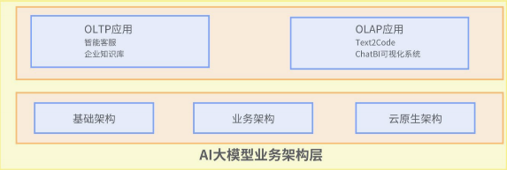
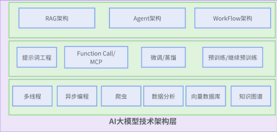
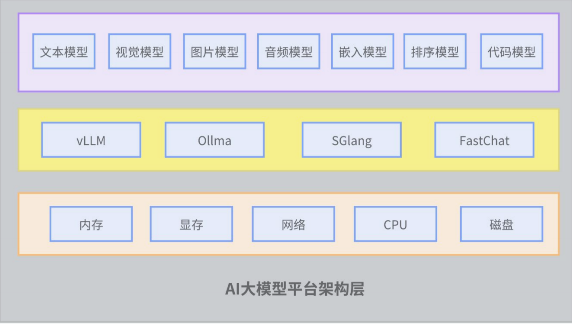

# 智能客服之架构设计

## AI大模型的业务架构层
  核心：支持超高并发、高性能、高可用
  - 基础架构、业务架构、云原生架构

## AI大模型的技术架构层
 核心：解决技术问题
 - RAG架构、Agent架构、WorkFlow架构
 - 大模型技术：提示词工程、Function Call/MCP、微调/蒸馏、预训练/继续预训练
 - 开发技术：多线程、异步编程、爬虫、数据分析、向量数据库、知识图谱
  

## AI大模型的平台架构层
 核心：解决部署问题
 - 资源的管理: 内存、显存、网络、C PU、磁盘等
 - 模型的部署: vLLM、Ollma、SGlang、FastChat等

