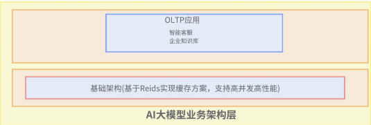
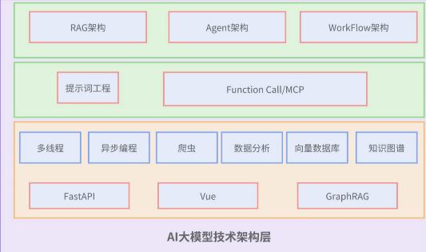
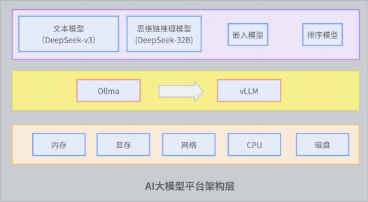

# 智能客服之技术选型

> 会议主题：智能客服项目（一期）整体技术选型
> 项目分期：一期为「智能助手」，二期为「智能客服」，三期视需求做微调/蒸馏优化

## AI大模型业务架构层

- **云原生**：本项目暂不直接使用；Ollama 的部署方式本身已包含容器化管理模型与资源的思想
- **业务架构**：项目复杂度不高（非电商级系统），不需要专职业务架构师，由产品经理自行梳理即可
- **基础架构（面向 C 端，需支撑高并发、高性能）**
  - 缓存：针对热点问题、高频访问问题做缓存，属传统 IT 架构手段，与大模型无关
  - 消息队列（MQ）：请求先进 MQ，再异步交给大模型处理，削峰并提升并发能力
  - 负载均衡：通过 Nginx 分发，部署多套实例支撑更高并发

## AI大模型的技术架构层

- **核心能力组合**：RAG + Agent + 工作流，单一技能已无法满足智能助手/客服的落地需求
- **大模型应用技术**：提示词工程（Prompt Engineering）、外部函数调用（Function Call、MCP）
- **微调与蒸馏**：本期暂不做；若二期对客服口吻、语气有特殊要求，或三期再考虑优化
- **传统开发技能**：异步编程、多线程、爬虫、数据分析、知识图谱、图数据库、向量数据库
- **技术栈**：后端 Python + FastAPI；前端 Vue
- **GraphRAG**（微软）：结合知识图谱增强 RAG 效果，检索质量更好

## AI大模型的平台架构层

- **资源维度**：内存、显存、网络、CPU、磁盘
- **部署方案对比**

| 对比项 | Ollama（一期采用） | vLLM（二期采用） |
| :--: | :--: | :--: |
| 定位 | 企业快速落地的轻量方案 | 线上生产级高性能方案 |
| 优势 | 快速起量、快速验证，技术与资源门槛低 | 性能更好、支持更高并发、推理更稳定 |
| 适用 | 技术实力/资源不足时的快速尝试 | 正式对外服务、高并发场景 |

- **模型选型**
  - 在线文本对话模型：DeepSeek-V3（约 6000+ 亿参数），走在线调用
  - 离线思维链推理模型：DeepSeek 32B，私有化部署（也可替换为私有化 Qwen 等，按数据安全要求灵活调整）
  - 嵌入（Embedding）模型、重排序（Rerank）模型：配合本地知识库使用，届时对比选型
- **部署后动作**：模型调优 → 并发压力测试，评估平台/模型可支撑的并发量与用户访问规模

## 结论
一期采用 Ollama + DeepSeek-V3（在线） + DeepSeek 32B（私有化）的方案完成智能助手；二期切换 vLLM 支撑智能客服的高并发场景。后续按「业务架构层 → 技术架构层 → 平台架构层」逐层实现。
