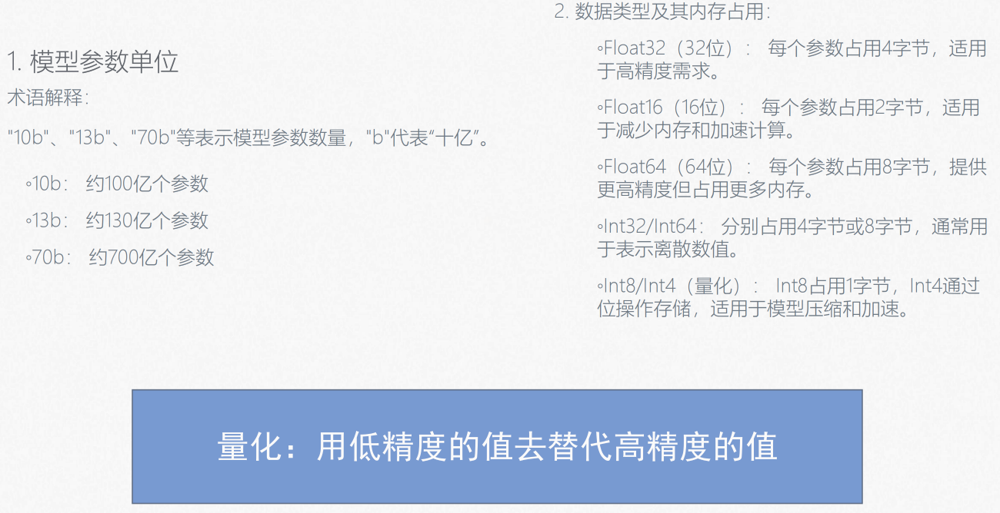
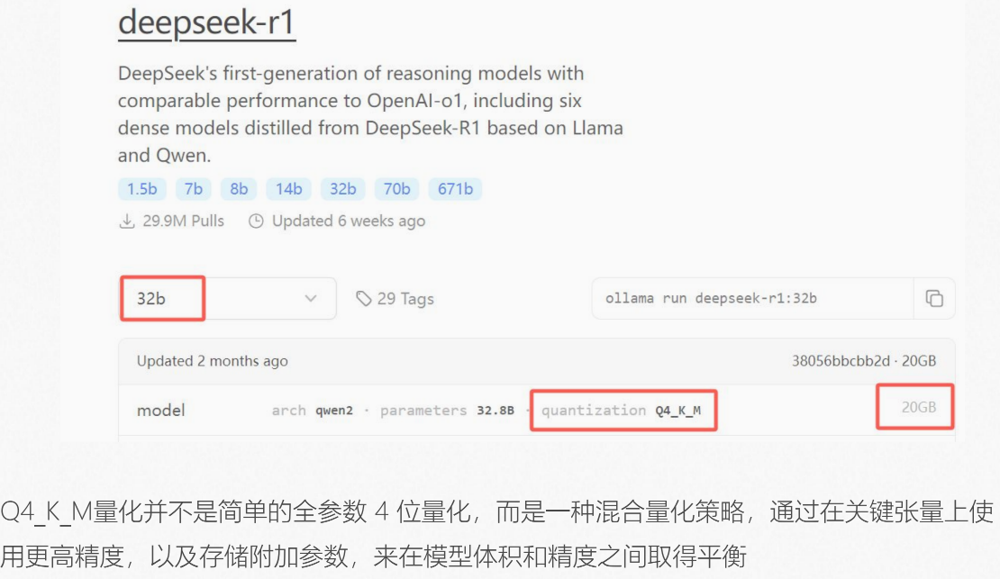
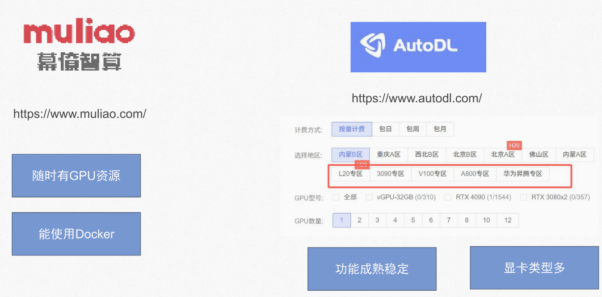

# 智能客服之资源评估

> 智能客服项目的算力与资源评估、服务器租赁
> 前置：平台架构层已确定一期 Ollama 部署 DeepSeek 32B，二期切换 vLLM

## 评估范围

| 组件 | 主要资源 | 备注 |
| :--: | :--: | :--: |
| DeepSeek-R1-Distill-Qwen-32B（私有化推理模型/思维链模型） | **GPU 显存** | 核心评估项 |
| DeepSeek-V3（在线文本对话模型） | 无（在线调用） | 暂不用考虑资源 |
| Redis（缓存层） | 内存 + CPU | 普通服务器即可 |
| 图数据库 / 向量数据库 | 内存、CPU、磁盘、网络 | 普通服务器即可 |
| Embedding / Rerank 模型 | 几百兆级别 | 忽略不计，不纳入统计 |

## 各阶段并发目标

| 阶段 | 部署方案 | 并发目标 | 适用场景 |
| :--: | :--: | :--: | :--: |
| 一期（智能助手） | Ollama | 5 并发 | 支撑 100 人以下团队使用 |
| 二期（智能客服） | vLLM | 100 并发 | 面向 C 端正式服务 |
| 三期 | vLLM + 其他架构方案 | 1000 并发 | 大规模生产级服务 |

## 模型体积与显存估算

### 参数单位与数据类型



- **参数单位**：B = 十亿，32B = 320 亿参数
- **数据类型占用**：

| 数据类型 | 每参数字节数 | 说明 |
| :--: | :--: | :--: |
| FP32 | 4 字节 | 高精度训练常用 |
| FP16 / BF16 | 2 字节 | 精度与体积的折中 |
| Int8 | 1 字节 | 量化压缩 |
| Int4 | 0.5 字节 | 更大压缩，精度更低 |

> **量化**：用低精度值替代高精度值，以较小精度损失换取更小的模型体积与更少的显存占用。

### DeepSeek 32B 在 Ollama 中的实际显存



- Ollama 可选：1.5B / 7B / 8B / 14B / 32B / 70B / 671B
- 本项目选用 **DeepSeek 32B**
- 纯 FP16 理论显存：32B × 2 字节 ≈ **64 GB**
- 本项目采用 Ollama 的 **Q4_K_M** 量化：
  - 不是简单的全参数 4 bit 量化，而是**混合量化策略**
  - 关键张量保留更高精度（6/8 bit），其余用 4 bit
  - 最终占用约 **20 GB 显存**（Ollama 页面标注）

## 算力平台选型



| 平台 | 特点 | 地址 |
| :--: | :--: | :--: |
| **幕僚（muliao）** | 随时有 GPU 资源、支持 Docker | [muliao.com](https://www.muliao.com/) |
| **AutoDL** | 功能成熟、显卡类型多、地区覆盖广、支持华为升腾 | [autodl.com](https://www.autodl.com/) |

> AutoDL 资源可能紧张，热门时段需等候；为便于跟着教程操作，推荐使用同一平台。

## 租赁方案（AutoDL）

| 配置项 | 选择 | 说明 |
| :--: | :--: | :--: |
| GPU | RTX 4090（24 GB 显存） | 20 GB 模型 + 余量 |
| 内存 | 120 GB | Redis + 图数据库 + 向量数据库绰绰有余 |
| CPU | 16 核 | 满足需求 |
| PyTorch 镜像 | 2.3.1 + Python 3.10/3.11/3.12 | 也可自行构建虚拟环境 |
| 计费 | 约 **2 元/小时** | 按量计费 |
| 国产化替代 | 华为升腾（昇腾专区） | 价格略贵，操作流程一致 |

## 整体资源评估总结

- **核心瓶颈**：DeepSeek 32B 的 GPU 推理显存（≈ 20 GB），因此 GPU 是唯一需要重点评估的资源
- **租机目标**：一台 RTX 4090（24 GB）服务器即可满足一期需求，内存 120 GB、CPU 16 核已覆盖 Redis / 图数据库 / 向量数据库
- **一期用 Ollama**：轻量、快速验证商业模式，待验证通过再升级 vLLM 应对高并发

## 模型的智商

[全球顶级模型排行榜](https://arena.ai/leaderboard)

### 大模型能力的七个维度

要衡量一个大模型的"智商"，需要从以下七个维度综合评估：

| 维度 | 说明 | 常用测试集（OpenCompass 内置） |
| :--: | :--: | :--: |
| **问答及翻译能力** | 跨语种理解、信息抽取、翻译准确度与流畅度 | BoolQ、PAWS-X、FLORES-101、CoT、AGIEval（语料理解类） |
| **角色扮演** | 按设定身份/语气进行长程、稳定的多轮对话 | IFEval、CRSEval、ICIEval（角色一致性与遵循指令） |
| **长文本编写** | 结构化写作、摘要、风格迁移、长上下文保持 | LongBench、L-Eval、LEVAL、HotpotQA |
| **数学解答** | 算术、代数、几何、应用题、竞赛级推理 | GSM8K、MATH、MMLU-Pro（数学子项）、CMMLU（数学） |
| **编程能力** | 代码生成、理解、调试、单测修复、跨语言 | HumanEval、MBPP、DS-1000、LiveCodeBench、SWE-bench |
| **科研能力** | 科学问答、文献理解、理论解释、实验设计 | SciEval、ScienceQA、GPQA、MMLU（科学子项）、AI4Sci |
| **逻辑推理（物理世界理解）** | 常识、反事实、空间关系、时间因果、规划 | CommonSenseQA、Winogrande、PIQA、SiQA、AR-LSAT、BBH |

> 以上只是典型代表集，OpenCompass 内置了 100+ 官方与社区数据集，可按需组合。

### OpenCompass（司南）评测实战

[OpenCompass](https://github.com/open-compass/opencompass) 是上海 AI Lab 开源的一站式大模型评测平台，支持基座模型、对话模型、多模态模型、国产硬件（华为昇腾）等，覆盖以上 7 个维度的绝大部分主流测试集。

#### 1. 安装

```bash
# 克隆源码 + 安装
git clone https://github.com/open-compass/opencompass
cd opencompass
conda create -n opencompass python=3.10 -y
conda activate opencompass
pip install -e .

# 下载官方内置数据集（可选，首次跑会自动下载）
python tools/download_dataset.py
```

#### 2. 评测流程：配置 → 推理 → 评估 → 可视化

OpenCompass 的评测以**配置文件**为中心，一个配置文件同时声明「要测什么模型」「要跑哪些数据集」「怎么推理和打分」。

**示例：评测 Ollama 上的 DeepSeek 32B**，从七个维度各选一个代表数据集：

```python
# configs/examples/deepseek32b_seven_dims.py

# ---------- 模型配置 ----------
from opencompass.models import OpenAI, VLLM

# 方案 A：本地 vLLM（适合私有化模型）
# model = VLLM(
#     model='deepseek-ai/DeepSeek-R1-Distill-Qwen-32B',
#     api_base='http://localhost:8000/v1',
#     max_out_len=1024,
#     temperature=0.7,
# )

# 方案 B：用 Ollama 起服务 + OpenAI 接口兼容调用
model = OpenAI(
    model='deepseek-r1:32b',          # ollama 里的 tag
    api_base='http://localhost:11434/v1',  # Ollama OpenAI 兼容端点
    api_key='EMPTY',
    max_out_len=2048,
    temperature=0.6,
)

# ---------- 数据集配置 ----------
# 七个维度各选一个代表集
datasets = [
    # 1. 问答及翻译 —— FLORES-101（中译英）
    dict(type='Flores', lang_pair='zh-en'),
    # 2. 角色扮演 —— IFEval（指令跟随 & 角色保持）
    dict(type='IFEval'),
    # 3. 长文本编写 —— LongBench（写作任务）
    dict(type='LongBench', subset='writing'),
    # 4. 数学 —— GSM8K（小学数学推理）
    dict(type='GSM8K'),
    # 5. 编程 —— HumanEval（代码生成）
    dict(type='HumanEval'),
    # 6. 科研 —— GPQA（研究生级科学问答）
    dict(type='GPQA'),
    # 7. 逻辑推理 / 物理世界理解 —— PIQA（物理常识）
    dict(type='PIQA'),
]

# ---------- 评测策略 ----------
eval = dict(
    evaluator=[dict(type='pass@1')],  # 编程用 pass@1；分类/问答默认 accuracy
    inferencer=dict(type='GenInferencer'),
    num_workers=4,
)
```

#### 3. 启动评测

```bash
# 单卡跑（推荐一期用 fast-eval 跑通流程）
python run.py configs/examples/deepseek32b_seven_dims.py \
    --accelerator cuda --num-gpus 1

# 跑通迷你集（5 条样本），节省时间
python run.py configs/examples/deepseek32b_seven_dims.py \
    --accelerator cuda --num-gpus 1 --debug
```

#### 4. 结果解读

OpenCompass 会生成三类产物：

| 产物 | 说明 |
| :--: | :--: |
| `results/<exp_name>/summary/<timestamp>.csv` | 各维度得分表（可直接贴进论文/汇报） |
| `results/<exp_name>/predictions/` | 每个样本的模型原始输出 + 标准答案，便于人工抽检 |
| `results/<exp_name>/logs/` | 推理日志，定位 OOM / 格式异常 |

**一个示例输出（截取）**：

| Dataset | Subset | Metric | DeepSeek-32B | GPT-4o | Qwen2.5-72B |
| :--: | :--: | :--: | :--: | :--: | :--: |
| GSM8K | - | pass@1 | 78.2 | 92.3 | 85.1 |
| HumanEval | - | pass@1 | 51.8 | 90.2 | 73.4 |
| PIQA | - | accuracy | 72.5 | 86.7 | 81.3 |
| FLORES | zh-en | BLEU | 23.4 | 38.1 | 30.9 |
| GPQA | - | accuracy | 48.0 | 71.5 | 55.2 |

> 可以看到，DeepSeek 32B 在数学（GSM8K）表现接近 Qwen2.5-72B，但编程（HumanEval）与 GPT-4o 仍有明显差距；翻译（FLORES）中文语料偏弱。这就是"智商不均衡"的典型表现，也为后续做模型选型 / 专项微调提供依据。

### 为什么要用 OpenCompass

- **开箱即用**：100+ 数据集、统一接口，一条命令跑完 7 个维度
- **硬件无关**：支持 NVIDIA、华为昇腾、AMD，也能只测在线 API
- **对标一致**：社区榜单普遍用它，能和 Arena、MMLU-Pro 等榜单直接对照
- **可扩展**：自己的业务数据集可以继承 `BaseDataset` 接进来，评测业务专属能力

### 建议的一期评测方案

本项目一期先聚焦**与智能助手强相关的四个维度**，控制评测成本：

```python
datasets = [
    dict(type='Flores', lang_pair='zh-en'),   # 问答/翻译
    dict(type='IFEval'),                      # 角色扮演（指令跟随）
    dict(type='LongBench', subset='writing'), # 长文本编写
    dict(type='GSM8K'),                       # 数学推理（DeepSeek-R1 的强项）
]
```

在 AutoDL 租的 RTX 4090 上，开启 `--debug` 迷你模式约 10 分钟就能跑通；全量评测约 1~2 小时。跑完就能用**数据**来判断「选哪个模型做主对话模型、哪个做思维链模型」，而不是只凭厂商宣传。

## 模型下载站与本地部署工具
[中文版模型下载-魔搭社区](https://www.modelscope.cn/)

[全球最大、最全的开源模型社区huggingface](https://huggingface.co/)

[本地模型部署工具ollama](https://ollama.com/)