## 智能客服之模型部署-部署工具安装

### 本地运行大模型集成框架Ollama介绍
**一、项目定位**
- Ollama 是 GitHub 上的开源项目，定位为**本地运行大模型的集成框架**
- 主要面向主流的 **LLaMA 架构**开源大模型设计
- 核心目标：帮助用户快速在本地运行大模型

**二、核心机制**
- 通过 **Modelfile** 将模型权重、配置文件和必要数据封装为一个包
- 借助该封装实现大模型**下载、启动、本地运行**的自动化部署与推理流程

**三、运行优化**
- 内置一系列针对大模型运行与推理的**优化策略**
- 极大简化了在 **Docker 容器**内部署和管理 LLM 的过程

**四、生态集成**
- 作为当前非常热门的大模型托管平台，与主流应用开发框架高度集成：
  - LangChain
  - AutoGen
  - Microsoft GraphRAG
- 与热门项目高度集成：
  - AnythingLLM
  - OpenWebUI

**五、使用体验**
 - 在远程有个仓库，里面有很多容器，容器里面部署好了很多开源的模型，对应的依赖和优化也弄好了
 - 找一台服务器，可以是Linux、Windows、Mac等
 - 执行一条命令就可以把这个工具安装好
 - 将Ollama的服务启动起来

- 安装指令简单
- 一条命令即可在本地运行开源大模型（如 Llama 2）

**六、官方地址**
- 网址：<https://ollama.com/>

**七、使用方式**

### 部署步骤
#### 第一步 租用算力服务器，配置如下

 - 选择2个GPU
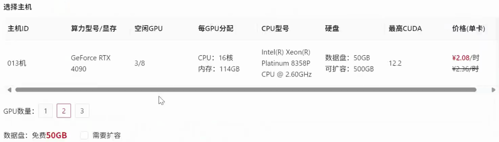
 - 选择镜像和框架名称/框架版本/Python版本/Cuda版本
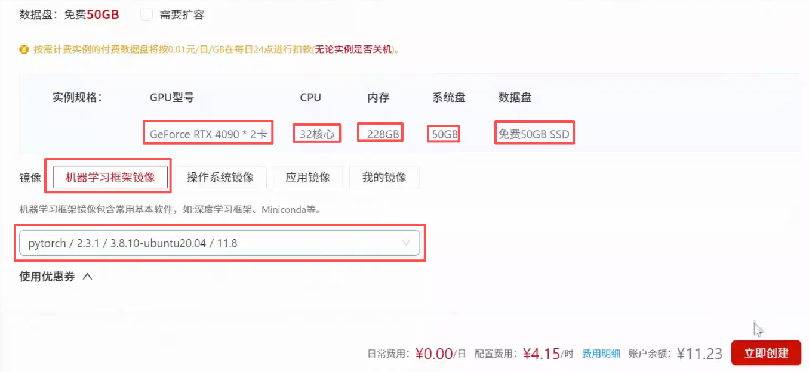

#### 第二步 安装Ollama
 - 进入服务器控制台
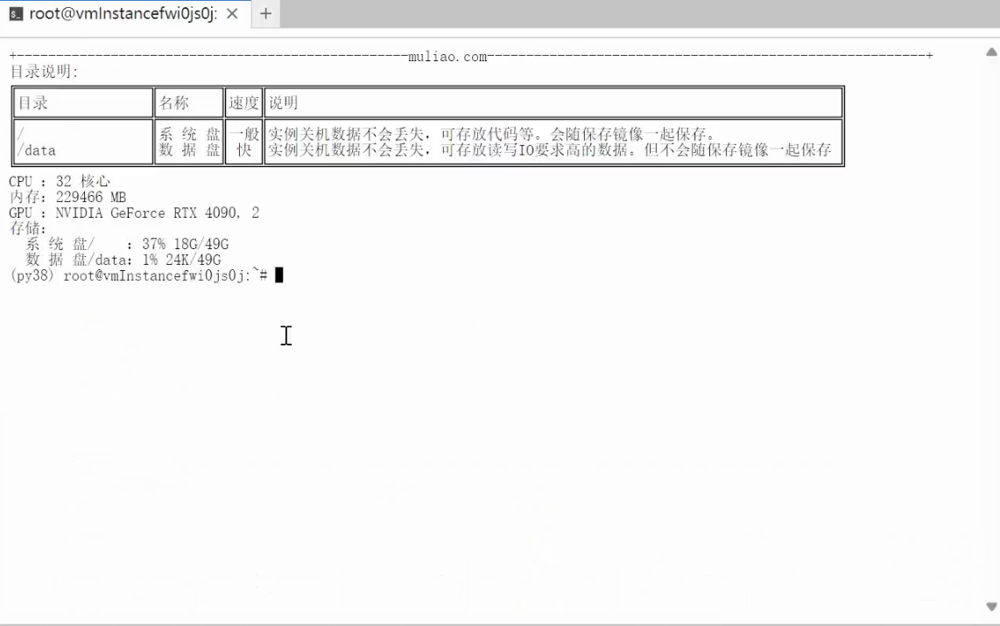
 - [Ollama网址](https://ollama.com/download/linux)
```bash
# 开启学术资源加速加载
source /etc/network_turbo
# 如果network_turbo文件不存在，北京一区、二区、三区等使用设置代理
export http_proxy=http://10.132.19.35:7890
export https_proxy=http://10.132.19.35:7890

# 执行Ollama安装命令
curl -fsSL https://ollama.com/install.sh | sh
```
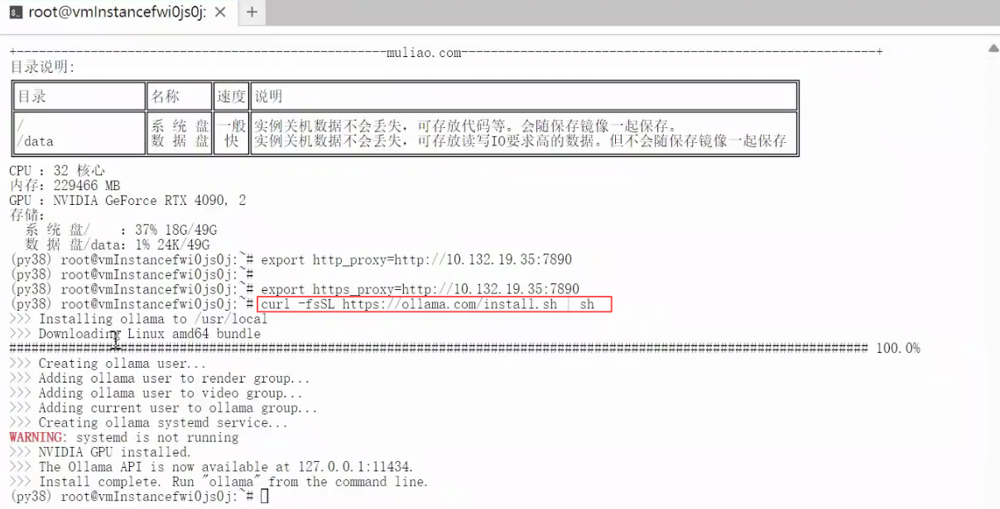

```bash
# 查看显卡信息
nvidia-smi命令
```
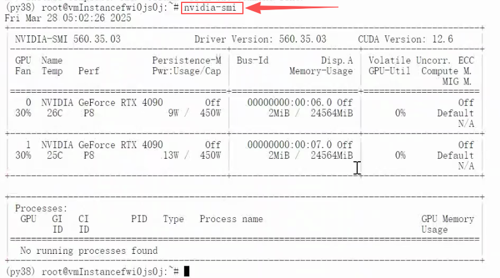

**一、顶部信息行**

| 字段 | 截图值 | 含义 |
| :--: | :--: | :--: |
| NVIDIA-SMI | 560.35.03 | 管理工具的版本 |
| Driver Version | 560.35.03 | 显卡驱动版本，与 SMI 版本一致说明驱动安装正常 |
| CUDA Version | 12.6 | 驱动支持的最高 CUDA 版本（上限，不等于实际运行版本） |

> 注意：截图中的 `root@vmlinstancefwiojs0j` 表示在云主机上以 root 身份执行；前面的 `(py38)` 是当前激活的 conda 环境名。

**二、GPU 硬件表（两行 = 两张卡）**

| 字段 | GPU 0 | GPU 1 | 含义 |
| :--: | :--: | :--: | :--: |
| Name | NVIDIA GeForce RTX 4090 | NVIDIA GeForce RTX 4090 | 消费级旗舰卡，24 GB 显存 |
| Fan | 30% | 30% | 风扇转速百分比 |
| Temp | 26C | 25C | 核心温度，接近待机温度 |
| Perf | P8 | P8 | 性能状态，P0 最高、P12 最低；P8 表示空闲低功耗 |
| Persistence-M | Off | Off | 持久模式，关闭时无任务会释放驱动上下文 |
| Pwr:Usage/Cap | 9W / 450W | 13W / 450W | 当前功耗 / 功耗上限；450W 是 4090 的 TDP，当前几乎空载 |
| Bus-Id | 00:06.0 | 00:07.0 | PCIe 总线地址，两张卡位于不同总线位置 |
| Disp.A | Off | Off | 是否接管显示输出（服务器无显示器，正常为 Off） |
| Memory-Usage | 2MiB / 24564MiB | 2MiB / 24564MiB | 已用 2MiB / 总显存 24564MiB ≈ 24 GB，说明模型还没加载 |
| Volatile Uncorr. ECC | N/A | N/A | 消费级卡不支持 ECC 纠错，属正常 |
| GPU-Util | 0% | 0% | GPU 计算利用率，0% 表示完全空闲 |
| Compute M. | Default | Default | 计算模式，Default 允许任意进程使用 |
| MIG M. | N/A | N/A | 不支持 MIG 显存切分（A100/H100 才有） |

**三、进程表**
- 没有任何进程占用 GPU，进一步印证机器处于完全空闲状态
- 后续部署模型后，这里会出现 Python / ollama 进程的 PID、Type（C = Compute 计算 / G = Graphics 图形）和显存占用

**四、关键结论与对本项目的意义**
1. 可用资源充足：两张 4090 合计约 48 GB 显存，而 DeepSeek 32B 在 Ollama 的 Q4_K_M 量化只需约 20 GB，单张卡即可跑下，另一张可留给 vLLM 或未来扩展。
2. 单位换算要看清：`24564MiB ≈ 24 GB`（MiB 是 2 的幂，与厂商标的 GB 略有差异），判断“能否装下模型”时以 MiB 为准更准确。
3. 部署后的验证基准：现在 `GPU-Util 0%`、`Memory-Usage 2MiB`。模型加载后应看到显存涨到 20 GB 左右；推理请求进来时 `GPU-Util` 会明显上升。这两个指标就是“部署成功”和“压力测试”的观测依据。
4. P8 状态是正常的：不要看到 P8 就以为显卡降频，空闲时降频省电是设计行为，有负载会自动切到 P0。
5. CUDA 12.6 只是驱动上限：实际用哪个 CUDA 版本由 PyTorch 决定，PyTorch 2.3.1 对应的 CUDA 版本会被包含在自己的 wheel 中，无需单独安装 CUDA Toolkit。

## 智能客服之模型部署-核心参数配置

**OLLAMA_HOST 参数**，:定义 Ollama 服务器的协议和主机地址。
```
定义 Ollama 服务器的协议和主机地址。默认为 127.0.0.1:11434，仅本机地址可通过 11434 端口访问该服务。
可以通过此变量自定义 Ollama 服务的监听地址和端口，例如设置为 
0.0.0.0:8080 ，可允许其他电脑访问 Ollama（如：局域网中的其他电脑）。
默认使用 http 协议。若要使用 https 协议，可设置为：
https://0.0.0.0:443
Environment="OLLAMA_HOST=0.0.0.0:11434"
```

**OLLAMA_MODELS 参数**:指定模型文件的存储路径。
```
指定模型文件的存储路径。默认为用户主目录下的 .ollama/models 文件夹。通过设置此变量，
可以自定义模型文件的存储位置，例如 OLLAMA_MODELS=/path/to/models 将模型存储在指定的路径下。
```

**OLLAMA_KEEP_ALIVE 参数**:控制模型在内存中的存活时间。
```
控制模型在内存中的存活时间。默认为 5 分钟。负值表示无限存活，0 表示不保持模型在内存中。
此变量用于优化模型加载和运行的性能，例如 OLLAMA_KEEP_ALIVE=30m 可以让模型在内存中保持 30 分钟。

为了满足速度和性能，我们设置为负数；
```

**OLLAMA_LOAD_TIMEOUT 参数**:设置模型加载过程中的超时时间。
```
设置模型加载过程中的超时时间。默认为 5 分钟。0 或负值表示无限超时。
此变量用于防止模型加载过程过长导致服务无响应，
例如 OLLAMA_LOAD_TIMEOUT=10m 可以将超时时间设置为 10 分钟。
```

**OLLAMA_MAX_LOADED_MODELS 参数**:限制同时加载的模型数量。
```
限制同时加载的模型数量。默认为 0，表示不限制。此变量用于合理分配系统资源，
避免过多模型同时加载导致资源不足，
例如 OLLAMA_MAX_LOADED_MODELS=4 可以限制同时加载 4 个模型。
```

**OLLAMA_MAX_QUEUE 参数**:设置请求队列的最大长度。
```
设置请求队列的最大长度。默认为 512。此变量用于控制并发请求的数量，避免过多请求
同时处理导致服务过载，例如 OLLAMA_MAX_QUEUE=1024 可以将队列长度设置为 1024。
```

**OLLAMA_MAX_VRAM 参数**:设置 GPU 显存的最大使用量
```
设置 GPU 显存的最大使用量（以字节为单位）。默认为 0，表示不限制。此变量用于控制
GPU 资源的使用，避免显存不足导致的问题，例如 OLLAMA_MAX_VRAM=8589934592
可以将显存限制为 8GB。
```

### 参数配置方式
```bash
# 配置网络参数
# 进入编辑环境
vi /etc/systemd/system/ollama.service
```
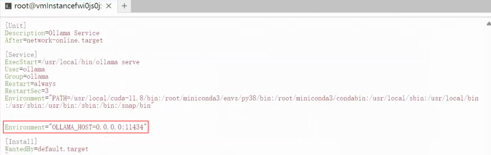
```bash
# 退出
:wq!
# 重新加载Ollama服务
systemctl daemon-reload
# 重启Ollama服务
systemctl restart ollama
```

```bash
# 查看是否正常
systemctl status ollama
```
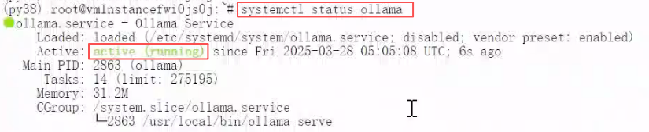

```bash
# 配置模型路径 在数据盘
cd data
# 创建目录
mkdir model
# 给目录一个权限，不然Ollama没有权限往里面写数据,否则会报错
chmod 777 model
cd ..
```
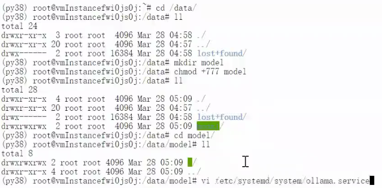

```bash
# 修改配置文件
vi /etc/systemd/system/ollama.service
```
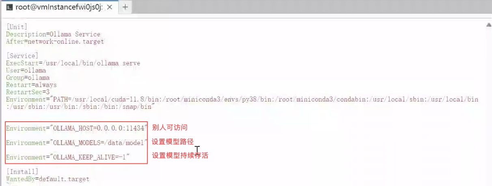

```bash
# 退出
:wq!
# 重新加载Ollama服务
systemctl daemon-reload
# 重启Ollama服务
systemctl restart ollama
```
### 下载并部署deepseek模型
#### 进入Ollama网址选择deepseek 32b模型
[Ollama网址](https://ollama.com/search)
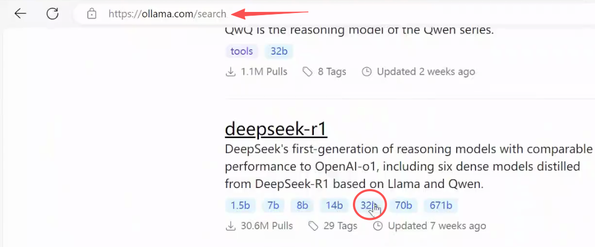
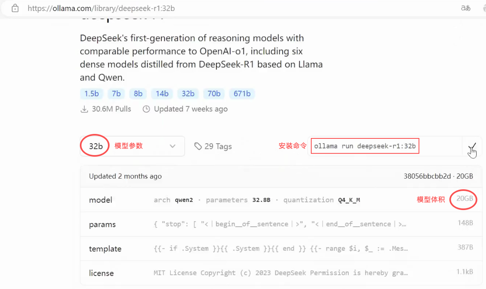
#### 下载模型
```bash
# 该命令表示 先运行这个模型，如果该模型不存在 就先下载再运行
ollama run deepseek-r1:32b
```
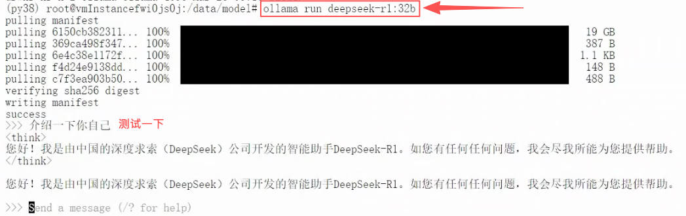

 - 查询显存的使用
```bash
# 查询显存使用
nvidia-smi
```
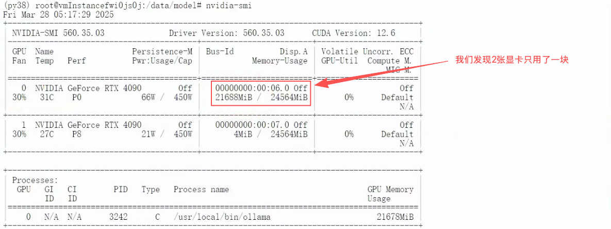

## 智能客服之模型部署-GPU负载均衡设计
### 停掉模型
```bash
# 将模型停掉
ollama stop deepseek-r1:32b
# 查询显存使用，发现不在占用显存了
nvidia-smi
```
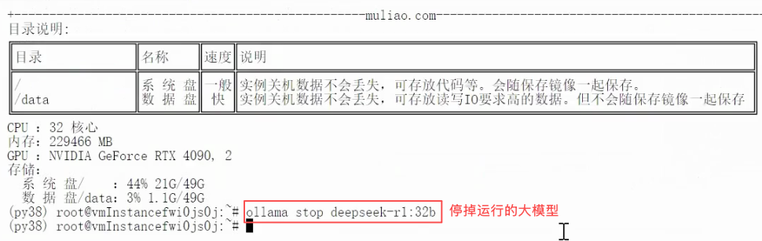
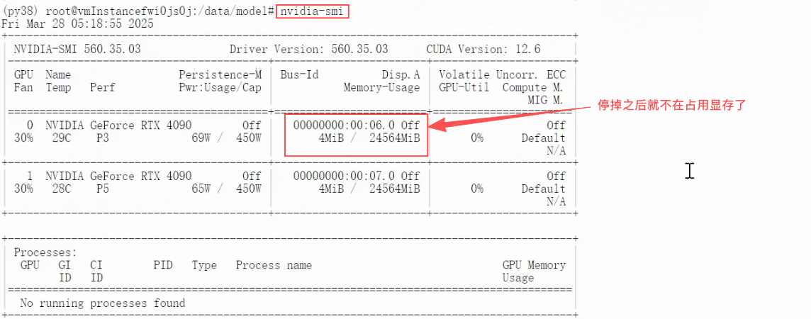

### **配置负载均衡参数**
```bash
# 1.进入编辑环境
vi /etc/systemd/system/ollama.service
# 2.修改配置文件
# 0,1,2 表示显卡编号，从0开始 默认情况下从0开始用，当第0块显存不够了再启用下一块
Environment="CUDA_VISIBLE_DEVICES=0,1,2"
# 配置负载均衡参数 这个参数是做负载均衡
Environment="OLLAMA_SCHED_SPREAD=1"
```
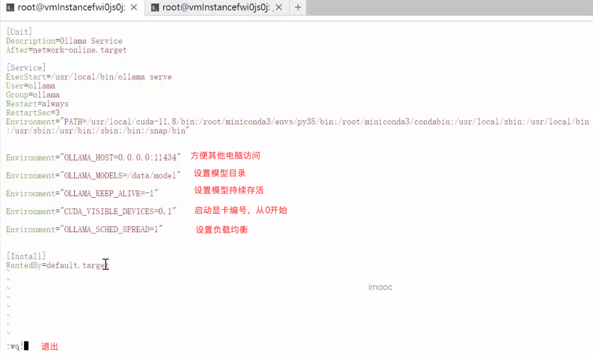

```bash
# 重新加载Ollama服务
systemctl daemon-reload
# 重启Ollama服务
systemctl restart ollama
# 查询启动状态
systemctl status ollama
```
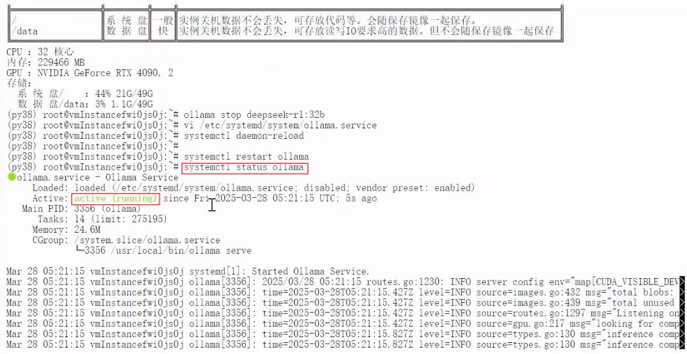
```bash
# 启动deepseek-r1:32b模型
ollama run deepseek-r1:32b
```
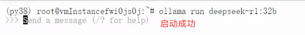
### 查询显卡状态
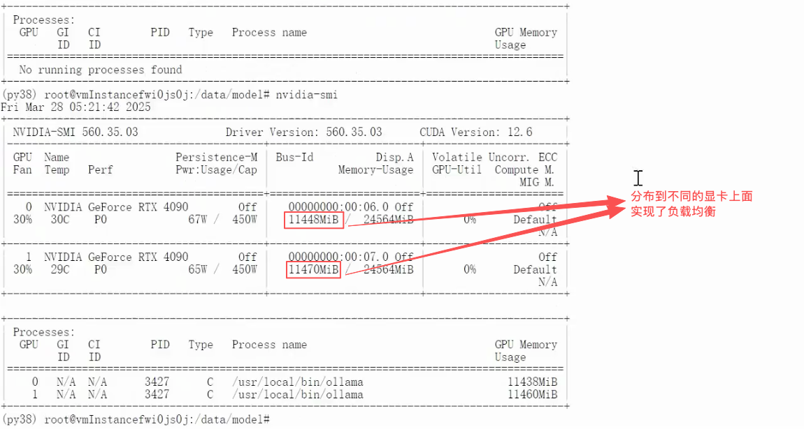

### Ollama常用命令介绍
 | 命令 | 用途 |
| :-- | :-- |
| `ollama serve` | 在本地系统上启动 Ollama。 |
| `ollama create <new_model>` | 从现有模型创建一个新模型，用于定制或训练。 |
| `ollama show <model>` | 显示特定模型的详细信息，例如其配置和发布日期。 |
| `ollama run <model>` | 运行指定的模型，使其准备好进行交互。 |
| `ollama pull <model>` | 将指定的模型下载到您的系统。 |
| `ollama list` | 列出所有已下载的模型。 |
| `ollama ps` | 显示当前正在运行的模型。 |
| `ollama stop <model>` | 停止指定的正在运行的模型。 |
| `ollama rm <model>` | 从您的系统中移除指定的模型。 |

## 智能客服之模型压力测试-API实践
### 安装OpenAI的SDK
```bash
pip install openai
```
&emsp;&emsp;本 `OpenAI` 的 `API` 接口是大模型应用开发中最常用、且集成度最高的 `API` 接口规范，其兼容接口主要包括：

- `chat/completions`
- `completions`
- `models`
- `embeddings`

### **非流式调用**
- 查询模型名称
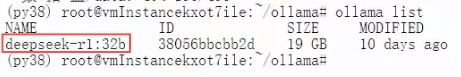
```bash
from openai import OpenAI # type: ignore

client = OpenAI(
    base_url='http://localhost:11434/v1/',     # 这里可以修改成可访问的 IP
    api_key='ollama',   # 这里随便写，但是api_key字段一定要有
)

chat_completion = client.chat.completions.create(
    model='deepseek-r1:32b', # 上面查询已部署的模型名称
    messages=[
        {
            'role': 'user',
            'content': '什么是机器学习？',
        }
    ],
)

print(chat_completion.choices[0].message.content)
```

### **流式调用**
```bash
from openai import OpenAI

client = OpenAI(
    base_url='http://localhost:11434/v1/',
    api_key='ollama',
)

messages = [
    {
        'role': 'user',
        'content': '什么是机器学习？',
    }
]

try:
    # 调用聊天接口
    stream = client.chat.completions.create(
        model='deepseek-r1:32b',
        messages=messages,
        stream=True # 开启流式调用
    )
    
    # 处理流式响应
    for chunk in stream:
        if chunk.choices[0].delta.content is not None:
            print(chunk.choices[0].delta.content, end='', flush=True)
            
except Exception as e:
    print(f"发生错误: {str(e)}")
```
### Ollama支持的模型参数
&emsp;&emsp;在`OpenAI Compatibility` 规范下，目前`Ollama` 支持的模型参数如下：

 - 支持的功能

 | 功能                     | 描述               |
|:--:|:--:|
| 聊天                | Chat completions    |
| 流媒体                   | Streaming           |
| JSON模式                 | JSON mode           |
| 可再现的输出             | Reproducible outputs |
| 视觉                     | Vision              |
| 工具                     | Tools               |

 - 支持的请求字段

 | 请求字段                | 描述                     |
|:--:|:--:|
| model                   | 模型                     |
| messages                | 消息                     |
| frequency_penalty       | 频率惩罚                 |
| presence_penalty        | 存在惩罚                 |
| response_format         | 响应格式                 |
| seed                    | 种子                     |
| stop                    | 停止                     |
| stream                  | 流式输出                 |
| stream_options          | 流式选项                 |
| include_usage           | 包含使用情况             |
| temperature             | 温度                     |
| top_p                  | Top-p 采样              |
| max_tokens              | 最大令牌数               |
| tools                   | 工具                     |

```bash
from openai import OpenAI

client = OpenAI(
    base_url='http://localhost:11434/v1/',
    api_key='ollama',
)

messages = [
    {
        'role': 'user',
        'content': '什么是机器学习？',
    }
]

try:
    # 调用聊天接口
    stream = client.chat.completions.create(
        model='deepseek-r1:32b',
        messages=messages,
        stream=True, # 设置流式输出
        temperature=0.7, # 设置回答温度
        max_tokens=1024, # 设置输出最大token数
    )
    
    # 处理流式响应
    for chunk in stream:
        if chunk.choices[0].delta.content is not None:
            print(chunk.choices[0].delta.content, end='', flush=True)
            
except Exception as e:
    print(f"发生错误: {str(e)}")
```
### ollama /api/generate API实践

- `/api/generate` 接口对应 `OpenAI` 的 `completions` 接口；
- `/api/chat` 接口对应 `OpenAI` 的 `chat/completions` 接口；

&emsp;&emsp;Ollama 服务启动后会提供一系列原生 ` REST API` 端点。通过这些`Endpoints`可以在代码环境下与`ollama`启动的大模型进行交互、管理模型和获取相关信息。其中两个`endpoint` 是最重要的，分别是：
  - <font color="red">**POST /api/generate**</font>
  - <font color="red">**POST /api/chat**</font>

&emsp;&emsp;其他端点情况：
  - POST /api/create   
  - POST /api/tags
  - POST /api/show
  - POST /api/copy
  - DELETE /api/delete
  - POST /api/pull
  - POST /api/push
  - POST /api/embed
  - GET /api/ps

### /api/generate 接口参数概览

&emsp;&emsp;该接口使用提供的模型为给定提示生成响应。这是一个流式端点，因此会有一系列响应。最终响应对象将包括统计信息和请求中的其他数据。其中比较重要的参数我做了标红处理，大家重点理解。
<style>
.center 
{
  width: auto;
  display: table;
  margin-left: auto;
  margin-right: auto;
}
</style>

<p align="center"><font face="黑体" size=4>常规参数</font></p>
<div class="center">

| 参数名      | 类型      | 描述                                                         |
| ----------- | --------- | ------------------------------------------------------------ |
| <font color="red">**model**</font>   | *(必需)*  | 模型名称，必须遵循 `model:tag` 格式，如果不提供，则将默认为 `latest`。 |
| <font color="red">**prompt**</font>  | *(必需)*  | 用于生成响应的提示。                                         |
| **suffix**  | *(可选)*  | 模型响应后的文本。                                         |
| **images**  | *(可选)*  | base64 编码图像的列表（适用于多模态模型，如 llava）。      |

</div>

<p align="center"><font face="黑体" size=4> 高级参数 (可选)</font></p>
<div class="center">

| 参数名      | 类型      | 描述                                                         |
| ----------- | --------- | ------------------------------------------------------------ |
| <font color="red">**format**</font>  | *(可选)*  | 返回响应的格式。格式可以是 `json` 或 JSON 模式。<font color="red">最主要的问题是避免产生大量空格</font>         |
| <font color="red">**options**</font> | *(可选)*  | 文档中列出的其他模型参数，例如 `temperature`。              |
| <font color="red">**system**</font>  | *(可选)*  | 系统消息，用于覆盖 Modelfile 中定义的内容。                 |
| **template**| *(可选)*  | 要使用的提示模板，覆盖 Modelfile 中定义的内容。             |
| <font color="red">**stream**</font>  | *(可选)*  | 如果为 `false`，响应将作为单个响应对象返回，而不是对象流。 |
| **raw**     | *(可选)*  | 如果为 `true`，则不会对提示应用格式。                       |
| <font color="red">**keep_alive**</font> | *(可选)* | 控制模型在请求后保持加载的时间（默认：5分钟），负数为长存。             |
| **context** | *(可选)*  | *(已弃用)* 从先前请求返回的上下文参数，用于保持简短的对话记忆。 |
</div>

&emsp;&emsp;其中，Options参数详细解释如下，同样我对重点参数做了标红处理，大家重点理解。

| 参数名 | 描述 | 值类型 | 示例用法 |
| --------------- | ------------------------------------------------------------ | ------ | ---------------------- |
| mirostat | 启用 Mirostat 采样以控制困惑度。（默认：0，0 = 禁用，1 = Mirostat，2 = Mirostat 2.0） | int | mirostat 0 |
| mirostat_eta| 影响算法对生成文本反馈的响应速度。较低的学习率会导致调整较慢，而较高的学习率会使算法更具响应性。（默认：0.1） | float | mirostat_eta 0.1 |
| mirostat_tau| 控制输出的连贯性和多样性之间的平衡。较低的值会导致更集中和连贯的文本。（默认：5.0） | float | mirostat_tau 5.0 |
| <font color="red">num_ctx</font> | 设置用于生成下一个标记的上下文窗口大小。（默认：2048）, 影响的是模型可以一次记住的最大 token 数量。 | int | num_ctx 4096|
| repeat_last_n| 设置模型回溯的范围以防止重复。（默认：64，0 = 禁用，-1 = num_ctx） | int | repeat_last_n 64 |
| repeat_penalty| 设置惩罚重复的强度。较高的值（例如 1.5）会更强烈地惩罚重复，而较低的值（例如 0.9）会更宽松。（默认：1.1） | float | repeat_penalty 1.1 |
| <font color="red">temperature</font> | 模型的温度。增加温度会使模型的回答更具创造性。（默认：0.8） | float | temperature 0.7 |
| seed | 设置用于生成的随机数种子。将其设置为特定数字将使模型对相同提示生成相同的文本。（默认：0） | int | seed 42 |
| <font color="red">stop</font> | 设置使用的停止序列。当遇到此模式时，LLM 将停止生成文本并返回。可以通过在 modelfile 中指定多个单独的停止参数来设置多个停止模式。 | string | stop "AI assistant:" |
| <font color="red">num_predict</font> | 生成文本时要预测的最大标记数。（默认：-1，无限生成）,影响模型最大可以生成的 token 数量。 | int | num_predict 42 |
| top_k | 降低生成无意义文本的概率。较高的值（例如 100）会给出更多样化的答案，而较低的值（例如 10）会更保守。（默认：40） | int | top_k 40 |
| top_p | 与 top-k 一起工作。较高的值（例如 0.95）会导致更具多样性的文本，而较低的值（例如 0.5）会生成更集中和保守的文本。（默认：0.9） | float | top_p 0.9 |
| min_p | top_p 的替代方案，旨在确保质量和多样性之间的平衡。参数 p 表示考虑标记的最小概率，相对于最可能标记的概率。例如，p=0.05 时，最可能的标记概率为 0.9，值小于 0.045 的 logits 会被过滤掉。（默认：0.0） | float | min_p 0.05 |

&emsp;&emsp;对于`endpoints`来说，如果使用代码调用，常规的调用方式是通`requests`库进行调用。如下所示：

```bash
import requests # type: ignore
import json

# 设置 API 端点
generate_url = "http://localhost:11434/api/generate"    # 这里需要根据实际情况进行修改

# 示例数据
generate_payload = {
    "model": "deepseek-r1:32b", 
    "prompt": "什么是机器学习？",  # 这里需要根据实际情况进行修改
    "stream": False,       # 默认使用的是True
}

# 调用生成接口
response_generate = requests.post(generate_url, json=generate_payload)
if response_generate.status_code == 200:
    generate_response = response_generate.json()
    print("生成响应:", json.dumps(generate_response, ensure_ascii=False, indent=2))
else:
    print("生成请求失败:", response_generate.status_code, response_generate.text)
```

```
生成响应: {
  "model": "deepseek-r1:32b",
  "created_at": "2025-04-08T01:33:20.470656272Z",
  "response": "<think>\n嗯，我现在要弄清楚什么是机器学习。这对我来说是一个全新的概念，所以我得一步一步慢慢理清楚。\n\n首先，我记得机器学习和人工智能有关，对吧？人工智能是让计算机像人一样思考或行动的领域，而机器学习应该是其中的一部分。不过具体是什么呢？\n\n听说机器学习涉及数据和模型。可能就是用大量的数据来训练模型，然后让模型自己去预测或者做出决策。那这跟传统编程有什么不同呢？传统编程是程序员写好规则，计算机按部就班执行，而机器学习是不是让计算机从数据中自己发现规律？\n\n举个例子，比如分类问题，像是识别图片中的猫和狗。传统方法可能需要手动设定很多特征，比如猫有胡须、尖耳朵等等，然后编写规则来判断。但机器学习可能是用很多带标签的图像喂给模型，让它自己学出这些特征，这样更高效。\n\n那机器学习有什么应用场景呢？比如推荐系统，像 Netflix 给你推荐电影；或者是语音识别，比如 Siri 或者 Alexa 能听懂我说的话。还有像自动驾驶汽车，它们需要处理大量的传感器数据来做决策。\n\n然后是机器学习的不同类型，我记得有监督学习、无监督学习和强化学习。有监督学习应该是用带标签的数据来训练模型，预测新的数据结果；无监督学习可能是在没有标签的情况下发现数据中的结构，比如聚类；强化学习则是通过试错，根据奖励信号调整策略。\n\n那机器学习的流程大概是怎样的呢？首先是收集数据，然后清洗处理，接着选择合适的算法，训练模型，调优参数，最后评估和部署。这些步骤听起来有点复杂，可能需要很多时间和计算资源。\n\n不过，机器学习也有挑战，比如数据的质量和数量，模型可能会过拟合或者欠拟合，解释性的问题，以及隐私和伦理问题。这些都是需要考虑的因素。\n\n我还记得一些常用的算法，比如线性回归、支持向量机、决策树、神经网络等等。深度学习是机器学习的一个子集，使用多层的神经网络来处理复杂的数据模式。\n\n总的来说，机器学习是一种通过数据让计算机自动学习并做出预测或决策的方法，它在很多领域都有广泛的应用，但同时也面临一些技术和伦理上的挑战。\n</think>\n\n机器学习（Machine Learning）是一门人工智能的分支科学，专注于构建算法模型，使计算机能够从数据中学习并自主改进。以下是对其核心概念和相关内容的详细阐述：\n\n### 核心概念\n1. **数据驱动**：机器学习依赖大量数据进行训练，通过分析这些数据发现规律并生成预测或决策。\n2. **算法与模型**：使用各种算法（如线性回归、神经网络）构建模型，能够从数据中提取特征和模式。\n3. **自动改进**：无需显式编程，模型通过经验（数据）自我优化，提升性能。\n\n### 主要类型\n1. **有监督学习**：利用带标签的数据训练模型，用于预测新数据结果（如分类、回归）。\n2. **无监督学习**：处理无标签数据，发现内在结构或模式（如聚类、降维）。\n3. **强化学习**：通过试错和奖励机制，优化策略以最大化累积奖励。\n\n### 应用场景\n- **推荐系统**：基于用户行为推荐内容。\n- **语音识别**：将语音转换为文本。\n- **图像识别**：分类和识别视觉内容。\n- **自然语言处理**：分析和生成人类语言。\n- **自动驾驶**：处理传感器数据，做出驾驶决策。\n\n### 优势与挑战\n- **优势**：无需显式编程，适应复杂任务，持续改进。\n- **挑战**：需大量高质量数据，模型可能过拟合或欠拟合，解释性问题及隐私伦理考量。\n\n机器学习正广泛应用于各个领域，推动技术进步，同时带来新的研究和应用挑战。",
  "done": true,
  "done_reason": "stop",
  "context": [
    151644,
    106582,
    102182,
    100134,
    11319,
    151645,
    151648,
    198,
    106287,
    3837,
    107520,
    30534,
    102115,
    101222,
    106582,
    102182,
    100134,
    1773,
...
  "prompt_eval_duration": 23614533,
  "eval_count": 821,
  "eval_duration": 21998543250
}
Output is truncated. View as a scrollable element or open in a text editor. Adjust cell output settings...
```

&emsp;&emsp;返回的响应中包含以下参数，其对应的描述如下：

<style>
.center 
{
  width: auto;
  display: table;
  margin-left: auto;
  margin-right: auto;
}
</style>

<p align="center"><font face="黑体" size=4>响应参数</font></p>
<div class="center">

| 参数名                  | 描述(时间单位:纳秒，1秒=10⁹纳秒)                                                         |
| ----------------------- | ------------------------------------------------------------ |
| **total_duration**      | 单次响应花费的总时间                                          |
| **load_duration**       | 加载模型花费的时间                                   |
| **prompt_eval_count**   | 提示中的token数                                               |
| **prompt_eval_duration**| 评估提示所花费的时间（以纳秒为单位）                                 |
| **eval_count**          | 响应中的token数                                               |
| **eval_duration**       | 生成响应的时间（以纳秒为单位）                              |
| **context**             | 在此响应中使用的对话的编码，可以在下一个请求中发送以保持对话记忆 |
| **response**            | 空响应是流的，如果未流式传输，则将包含完整的响应             |

</div>

&emsp;&emsp;返回的响应体中重点关注以下几个参数：

### response 参数格式化解析

&emsp;&emsp;`response` 字段指的是模型生成的实际输出内容。对于 `DeepSeek-R1` 模型来说，`response` 字段中包含<think> 标签和正常文本，<think> 标签用于表示模型的思考过程或内部推理，而正常的文本则是模型生成的实际输出内容。注意：非推理类模型的返回结果中没有<think></think>标识。

```bash
print(generate_response["response"])
```

```
<think>
嗯，我现在要理解一下什么是机器学习。好像机器学习是现在很热门的一个领域，但我对它的了解还不深。首先，我记得机器学习和人工智能有关系，但具体是什么样的关系呢？

我好像听说过，机器学习让计算机能够从数据中学习，而不是通过明确的编程指令来完成任务。这有点像人类通过经验学习一样，对吧？比如说，当我们要识别图片中的猫时，传统的编程方法可能需要手动编写很多规则和条件来判断一张图是不是猫，但这样做可能很繁琐，而且效果不一定好。而机器学习的方法则是让计算机自己分析大量的猫的图片，从中找出规律，然后自己学会如何识别猫。

那机器学习具体是怎么工作的呢？我记得有个过程叫做训练模型，也就是用大量数据来调整算法的参数，使得它能够准确地预测或分类新的数据。比如，在图像识别中，使用卷积神经网络（CNN）这样的模型，通过训练，让它能够识别各种不同的图像类别。

机器学习还有监督学习和无监督学习的区别，对吗？监督学习是用有标签的数据来训练模型，比如给定很多图片并告诉计算机哪些是猫、哪些不是，然后它学会分类。而无监督学习则是在没有标签的情况下，让模型自己发现数据中的结构或模式，比如聚类分析，把相似的数据点分组在一起。

还有强化学习，这好像是通过奖励和惩罚机制来训练模型，让它在环境中做出决策，最大化某种累积奖励。比如游戏AI在玩一个游戏时，会根据得分来调整自己的策略，逐渐变得更强。

机器学习的应用场景很广泛，我听说可以用它来做预测，比如房价预测、股票走势分析；也可以用于自然语言处理，比如翻译和文本生成；还有推荐系统，像 Netflix 或 Amazon 用机器学习来推荐用户可能喜欢的内容。当然，图像识别也是一个大领域，比如人脸识别和自动驾驶汽车的视觉系统。

不过，机器学习也有它的挑战。首先，数据的质量非常重要，如果训练数据有偏差或者不够多样，模型可能会表现不佳。另外，模型的可解释性也是一个问题，有些复杂的模型，如深度神经网络，虽然效果好，但很难理解它们是如何做出决策的。还有计算资源的问题，训练大型模型需要大量的算力和时间。

机器学习的发展历程应该是从经典的算法开始，比如线性回归、支持向量机（SVM），再到近年来深度学习的兴起，使用多层神经网络取得了显著的进步。现在，随着计算能力的提升和大数据的普及，机器学习的应用范围越来越广，解决的问题也越来越复杂。

不过，我还是有点困惑，比如机器学习和人工智能有什么不同？是不是所有的AI都用到了机器学习？或者说，机器学习是实现AI的一种方法？

另外，听说机器学习中还有半监督学习、增强学习等其他类型，我需要更深入地了解这些概念。还有，如何选择合适的算法来解决具体的问题，这可能涉及到模型的评估和调优，比如交叉验证、超参数调整等等。

总的来说，机器学习是一个通过数据让计算机自动学习并做出预测或决策的领域，它涉及多种方法和技术，广泛应用于各个行业，但同时也面临一些挑战和需要考虑的因素。为了更好地理解它，我应该进一步学习具体的算法和应用案例，并尝试实际操作来加深理解和技能。
</think>

机器学习是一种通过数据使计算机具备自主学习能力的技术，无需明确编程即可完成任务。它属于人工智能领域，广泛应用于数据分析、模式识别等领域。
...
- 掌握模型评估和调优技巧，如交叉验证。
- 实践操作以加深理解和应用能力。

通过理解这些核心概念，可以更好地把握机器学习的潜力与挑战，并在实际中有效运用这一技术。
Output is truncated. View as a scrollable element or open in a text editor. Adjust cell output settings...
```

&emsp;&emsp;可以通过简单的字符串操作来分离 <think> 标签中的思考内容和正常的文本内容，代码如下：

```bash
# 提取 <think> 标签中的内容
think_start = generate_response["response"].find("<think>")
think_end = generate_response["response"].find("</think>")

if think_start != -1 and think_end != -1:
    think_content = generate_response["response"][think_start + len("<think>"):think_end].strip()
else:
    think_content = "No think content found."

# 提取正常的文本内容
normal_content = generate_response["response"][think_end + len("</think>"):].strip()

# 打印结果
print("思考文本:\n", think_content)
print("\n正式文本:\n", normal_content)
```

```
思考文本:
 嗯，我现在要理解一下什么是机器学习。好像机器学习是现在很热门的一个领域，但我对它的了解还不深。首先，我记得机器学习和人工智能有关系，但具体是什么样的关系呢？

我好像听说过，机器学习让计算机能够从数据中学习，而不是通过明确的编程指令来完成任务。这有点像人类通过经验学习一样，对吧？比如说，当我们要识别图片中的猫时，传统的编程方法可能需要手动编写很多规则和条件来判断一张图是不是猫，但这样做可能很繁琐，而且效果不一定好。而机器学习的方法则是让计算机自己分析大量的猫的图片，从中找出规律，然后自己学会如何识别猫。

那机器学习具体是怎么工作的呢？我记得有个过程叫做训练模型，也就是用大量数据来调整算法的参数，使得它能够准确地预测或分类新的数据。比如，在图像识别中，使用卷积神经网络（CNN）这样的模型，通过训练，让它能够识别各种不同的图像类别。

机器学习还有监督学习和无监督学习的区别，对吗？监督学习是用有标签的数据来训练模型，比如给定很多图片并告诉计算机哪些是猫、哪些不是，然后它学会分类。而无监督学习则是在没有标签的情况下，让模型自己发现数据中的结构或模式，比如聚类分析，把相似的数据点分组在一起。

还有强化学习，这好像是通过奖励和惩罚机制来训练模型，让它在环境中做出决策，最大化某种累积奖励。比如游戏AI在玩一个游戏时，会根据得分来调整自己的策略，逐渐变得更强。

机器学习的应用场景很广泛，我听说可以用它来做预测，比如房价预测、股票走势分析；也可以用于自然语言处理，比如翻译和文本生成；还有推荐系统，像 Netflix 或 Amazon 用机器学习来推荐用户可能喜欢的内容。当然，图像识别也是一个大领域，比如人脸识别和自动驾驶汽车的视觉系统。

不过，机器学习也有它的挑战。首先，数据的质量非常重要，如果训练数据有偏差或者不够多样，模型可能会表现不佳。另外，模型的可解释性也是一个问题，有些复杂的模型，如深度神经网络，虽然效果好，但很难理解它们是如何做出决策的。还有计算资源的问题，训练大型模型需要大量的算力和时间。

机器学习的发展历程应该是从经典的算法开始，比如线性回归、支持向量机（SVM），再到近年来深度学习的兴起，使用多层神经网络取得了显著的进步。现在，随着计算能力的提升和大数据的普及，机器学习的应用范围越来越广，解决的问题也越来越复杂。

不过，我还是有点困惑，比如机器学习和人工智能有什么不同？是不是所有的AI都用到了机器学习？或者说，机器学习是实现AI的一种方法？

另外，听说机器学习中还有半监督学习、增强学习等其他类型，我需要更深入地了解这些概念。还有，如何选择合适的算法来解决具体的问题，这可能涉及到模型的评估和调优，比如交叉验证、超参数调整等等。

总的来说，机器学习是一个通过数据让计算机自动学习并做出预测或决策的领域，它涉及多种方法和技术，广泛应用于各个行业，但同时也面临一些挑战和需要考虑的因素。为了更好地理解它，我应该进一步学习具体的算法和应用案例，并尝试实际操作来加深理解和技能。

正式文本:
 机器学习是一种通过数据使计算机具备自主学习能力的技术，无需明确编程即可完成任务。它属于人工智能领域，广泛应用于数据分析、模式识别等领域。
...
- 掌握模型评估和调优技巧，如交叉验证。
- 实践操作以加深理解和应用能力。

通过理解这些核心概念，可以更好地把握机器学习的潜力与挑战，并在实际中有效运用这一技术。
Output is truncated. View as a scrollable element or open in a text editor. Adjust cell output settings...
```

&emsp;&emsp;当然也可以用相同的方式提取返回的响应中所有参数的值：

### 打印每个参数的值
&emsp;&emsp;`Ollama` 返回的响应中，采用的时间单位均以纳秒返回。纳秒（nanosecond）和秒（second）之间的关系是：<font color="red">1 秒 = 10⁹ 纳秒</font>
```bash
print("Model:", generate_response["model"]) # 打印模型名称
print("Created At:", generate_response["created_at"]) # 打印创建时间
print("Response:", generate_response["response"]) # 打印模型生成的响应内容（含<think>思考过程）
print("Done:", generate_response["done"]) # 打印是否生成完成
print("Done Reason:", generate_response["done_reason"]) # 打印完成原因（如stop）
print("Context:", generate_response["context"]) # 打印本次对话的上下文编码（可用于保持对话记忆）
print("Total Duration:", generate_response["total_duration"]) # 打印单次响应花费的总时间（纳秒）
print("Load Duration:", generate_response["load_duration"]) # 打印加载模型花费的时间（纳秒）
print("Prompt Eval Count:", generate_response["prompt_eval_count"]) # 打印提示中的token数
print("Prompt Eval Duration:", generate_response["prompt_eval_duration"]) # 打印评估提示所花费的时间（纳秒）
print("Eval Count:", generate_response["eval_count"]) # 打印响应中的token数
print("Eval Duration:", generate_response["eval_duration"]) # 打印生成响应的时间（纳秒）
```

```bash
# 将纳秒转换为秒
total_duration_s = generate_response["total_duration"] / 1_000_000_000
load_duration_s = generate_response["load_duration"] / 1_000_000_000
prompt_eval_duration_s = generate_response["prompt_eval_duration"] / 1_000_000_000
eval_duration_s = generate_response["eval_duration"] / 1_000_000_000

# 打印转换后的秒值
print("单次调用总花费时间:", total_duration_s)
print("加载模型花费时间:", load_duration_s)
print("评估提示所花费的时间:", prompt_eval_duration_s)
print("生成响应的时间:", eval_duration_s)
```

```
单次调用总花费时间: 22.038704856
加载模型花费时间: 0.016130235
评估提示所花费的时间: 0.023614533
生成响应的时间: 21.99854325
```
### num_ctx / num_predict 输入输出控制

&emsp;&emsp;`num_ctx` 和 `num_predict`参数都是需要放置在 `options` 参数中的，其中：

- `num_ctx`该参数指的是大模型在一次对话中能够"看到"和"记住"的最大上下文长度，默认配置 2048，相当于一次只能向模型输入 2k `token`，超过 2k 模型就无法记住。当 `prompt` 特别长时往往会出现问题。并且现在开源模型往往支持长上下文，默认配置会严重限制本地模型能力。

- `num_predict` 参数指的是模型响应返回的最大 token 数据量。

&emsp;&emsp;我们可以这样测试：

```bash
import requests # type: ignore
import json

# 设置 API 端点
generate_url = "http://localhost:11434/api/generate"    # 这里需要根据实际情况进行修改

# 示例数据
generate_payload = {
    "model": "deepseek-r1:32b",   # 这里需要根据实际情况进行修改
    "prompt": "请生成一个关于机器学习的简短介绍。",  # 这里需要根据实际情况进行修改
    "stream": False,       # 默认使用的是True，如果设置为False，则返回的是一个完整的响应，而不是一个流式响应
    "options": {
        "num_predict": 15
    }
}

# 调用生成接口
response_generate = requests.post(generate_url, json=generate_payload)
if response_generate.status_code == 200:
    generate_response = response_generate.json()
    print("生成响应:", json.dumps(generate_response, ensure_ascii=False, indent=2))
else:
    print("生成请求失败:", response_generate.status_code, response_generate.text)
```

```
生成响应: {
  "model": "deepseek-r1:32b",
  "created_at": "2025-04-08T04:34:43.057340406Z",
  "response": "<think>\n好，我现在需要帮用户生成一个关于机器学习的简",
  "done": true,
  "done_reason": "length",
  "context": [
    151644,
    14880,
    43959,
    46944,
    101888,
    102182,
    100134,
    9370,
    98237,
    99534,
    100157,
    1773,
    151645,
    151648,
    198,
    52801,
    3837,
    107520,
...
  "prompt_eval_duration": 189977724,
  "eval_count": 15,
  "eval_duration": 386130974
}
Output is truncated. View as a scrollable element or open in a text editor. Adjust cell output settings...
```
 - 流式输出功能

&emsp;&emsp;接下来看流式输出输出，其参数和如上代码保持一致，只需要在 `response_generate` 中添加 `stream=True`，最后再通过流式的方式进行响应结果处理即可。代码如下所示：

> 这里有一个使用`DeepSeek-R1`的小技巧，将温度即`temperature`设置在0.5-0.7（建议0.6）的范围内，可以有效防止无尽的重复或不连贯的输出。

```bash
import requests # type: ignore
import json

# 设置 API 端点
generate_url = "http://localhost:11434/api/generate"

# 示例数据
generate_payload = {
    "model": "deepseek-r1:32b",
    "prompt": "请生成一个关于机器学习的简短介绍。",
    "options": {
        "temperature": 0.6, 
    }
}

# 调用生成接口 在这里添加stream=True
response_generate = requests.post(generate_url, json=generate_payload, stream=True)
if response_generate.status_code == 200:
    # 处理流式响应
    for line in response_generate.iter_lines(): 
        if line:
            try:
                # 解码并解析每一行的 JSON
                response_json = json.loads(line.decode('utf-8'))
                if 'response' in response_json:
                    print(response_json['response'], end='', flush=True)

                # 检查 response_json 字典中是否存在键 'done'，并且其值是否为 True。
                # 如果这个条件成立，表示生成的响应已经完成。
                if response_json.get('done', False):
                    print('\n\n完整响应:', 
                      json.dumps(response_json, ensure_ascii=False, indent=2)
                    )
            except json.JSONDecodeError as e:
                print(f"JSON 解析错误: {e}")
else:
    print("生成请求失败:", response_generate.status_code, response_generate.text)
```

### Ollama 模型生命周期管理

&emsp;&emsp;默认情况下，<font color="red">**通过`Ollama run`启动一个模型后，会将其在VRAM(显存)中保存5分钟**</font>。主要作用是为了做性能优化，通过保持模型在显存中，可以避免频繁的加载和卸载操作，从而提高响应速度，特别是在连续请求的情况下。

- <font color="red">**keep_alive**</font>

&emsp;&emsp;我们可以通过`ollama stop` 命令立即卸载某个模型。而在生成请求中，一种高效的方式是通过`keep_alive`参数来控制模型在请求完成后保持加载在内存中的时间。其可传入的参数规则如下：

<style>
.center 
{
  width: auto;
  display: table;
  margin-left: auto;
  margin-right: auto;
}
</style>

<p align="center"><font face="黑体" size=4>keep_alive 参数类型</font></p>
<div class="center">

| 参数类型               | 示例         | 描述                                       |
|------------------------|--------------|--------------------------------------------|
| 持续时间字符串         | "10m" 或 "24h" | 表示保持模型在内存中的时间，单位可以是分钟（m）或小时（h）。 |
| 以秒为单位的数字       | 3600         | 表示保持模型在内存中的时间，单位为秒。   |
| 任何负数               | -1 或 "-1m"  | 表示保持模型在内存中，负数值将使模型持续加载。 |
| '0'                    | 0            | 表示在生成响应后立即卸载模型。             |

</div>

```bash
import requests # type: ignore
import json

# 设置 API 端点
generate_url = "http://localhost:11434/api/generate"

# 示例数据
generate_payload = {
    "model": "deepseek-r1:32b",
    "prompt": "请生成一个关于机器学习的简短介绍。",
    "stream": False,
    "keep_alive": "10m",   # 设置模型在请求后保持加载的时间
    "options": {
        "temperature": 0.6,
    }
}

# 调用生成接口
response_generate = requests.post(generate_url, json=generate_payload)
if response_generate.status_code == 200:
    generate_response = response_generate.json()
    print("生成响应:", json.dumps(generate_response, ensure_ascii=False, indent=2))
else:
    print("生成请求失败:", response_generate.status_code, response_generate.text)

# 计算模型生成阶段的吞吐率（tokens per second），是压力测试的核心性能指标
if generate_response["eval_duration"] != 0:  # 判断生成耗时是否为0，避免除零错误
    # eval_count：响应中的token数；eval_duration：生成响应的耗时（单位纳秒），乘 10^9 换算成秒
    tokens_per_second = generate_response["eval_count"] / generate_response["eval_duration"] * 10**9
    print(f"Tokens per second: {tokens_per_second}")  # 打印每秒生成的token数
else:
    print("eval_duration is zero, cannot calculate tokens per second.")  # 耗时为0无法计算，打印错误提示
```

&emsp;&emsp;此时就可以在服务器控制台查看到，`deepseek-r1:32b`模型将可以在显存中保持10分钟。

&emsp;&emsp;`keep_alive` 在工程化的项目中，往往需要根据请求的频率来设置，如果请求不频繁，可以使用默认值或较短的时间，以便在不使用时释放内存。而如果应用程序需要频繁调用模型，可以设置较长的 `keep_alive` 时间，以减少加载时间。很关键，非常影响服务器的性能和应用程序的用户体验。大家一定要注意。

### Ollama REST API - api/chat

&emsp;&emsp;Ollama 服务启动后会提供一系列原生 ` REST API` 端点。通过这些`Endpoints`可以在代码环境下与`ollama`启动的大模型进行交互、管理模型和获取相关信息。其中两个`endpoint` 是最重要的，分别是：
  - <font color="red">**POST /api/generate**</font>
  - <font color="red">**POST /api/chat**</font>

&emsp;&emsp;其他端点情况：
  - POST /api/create   
  - POST /api/tags
  - POST /api/show
  - POST /api/copy
  - DELETE /api/delete
  - POST /api/pull
  - POST /api/push
  - POST /api/embed
  - GET /api/ps

### /api/chat 接口参数概览

&emsp;&emsp;该接口使用提供的模型在聊天中生成下一条消息。与 `/api/generate` 的参数基本一致，但是在请求的参数上会根据聊天场景进行调整。主要调整的是：
- 不再使用 `prompt` 参数，而是使用 `messages` 参数。
- 新增了 `tools` 参数，用于支持工具调用。

&emsp;&emsp;其可以使用的具体参数如下所示，

<style>
.center 
{
  width: auto;
  display: table;
  margin-left: auto;
  margin-right: auto;
}
</style>

<p align="center"><font face="黑体" size=4>常规参数</font></p>
<div class="center">

| 参数名       | 类型      | 描述                                                         |
| ------------ | --------- | ------------------------------------------------------------ |
| **model**    | *(必需)*  | 模型名称。                                                   |
| <font color="red">**messages**</font> | *(必需)*  | 聊天的消息，用于保持聊天记忆。                               |
| <font color="red">**tools**</font>    | *(可选)*  | JSON 中的工具列表，供模型使用（如果支持）。                 |

</div>


<p align="center"><font face="黑体" size=4>消息对象字段</font></p>
<div class="center">

| 字段名       | 描述                                                         |
| ------------ | ------------------------------------------------------------ |
| <font color="red">**role**</font>     | 消息的角色，可以是 `system`、`user`、`assistant` 或 `tool`。 |
| <font color="red">**content**</font>  | 消息的内容。                                                 |
| **images**   | *(可选)* 要在消息中包含的图像列表（适用于多模态模型，如 llava）。 |
| **tool_calls** | *(可选)* 模型希望使用的 JSON 中的工具列表。               |

</div>


<p align="center"><font face="黑体" size=4>高级参数 (可选)</font></p>
<div class="center">

| 参数名       | 描述                                                         |
| ------------ | ------------------------------------------------------------ |
| **format**   | 返回响应的格式。格式可以是 `json` 或 JSON 模式。            |
| <font color="red">**options**</font>  | 文档中列出的其他模型参数，例如 `temperature`。              |
| **stream**   | 如果为 `false`，响应将作为单个响应对象返回，而不是对象流。  |
| <font color="red">**keep_alive**</font> | 控制模型在请求后保持加载的时间（默认：5分钟）。           |

</div>

其中，Options参数说明：

| 参数名 | 描述 | 值类型 | 示例用法 |
| --------------- | ------------------------------------------------------------ | ------ | ---------------------- |
| mirostat | 启用 Mirostat 采样以控制困惑度。（默认：0，0 = 禁用，1 = Mirostat，2 = Mirostat 2.0） | int | mirostat 0 |
| mirostat_eta| 影响算法对生成文本反馈的响应速度。较低的学习率会导致调整较慢，而较高的学习率会使算法更具响应性。（默认：0.1） | float | mirostat_eta 0.1 |
| mirostat_tau| 控制输出的连贯性和多样性之间的平衡。较低的值会导致更集中和连贯的文本。（默认：5.0） | float | mirostat_tau 5.0 |
| <font color="red">num_ctx</font> | 设置用于生成下一个标记的上下文窗口大小。（默认：2048）, 影响的是模型可以一次记住的最大 token 数量。 | int | num_ctx 4096|
| repeat_last_n| 设置模型回溯的范围以防止重复。（默认：64，0 = 禁用，-1 = num_ctx） | int | repeat_last_n 64 |
| repeat_penalty| 设置惩罚重复的强度。较高的值（例如 1.5）会更强烈地惩罚重复，而较低的值（例如 0.9）会更宽松。（默认：1.1） | float | repeat_penalty 1.1 |
| <font color="red">temperature</font> | 模型的温度。增加温度会使模型的回答更具创造性。（默认：0.8） | float | temperature 0.7 |
| seed | 设置用于生成的随机数种子。将其设置为特定数字将使模型对相同提示生成相同的文本。（默认：0） | int | seed 42 |
| <font color="red">stop</font> | 设置使用的停止序列。当遇到此模式时，LLM 将停止生成文本并返回。可以通过在 modelfile 中指定多个单独的停止参数来设置多个停止模式。 | string | stop "AI assistant:" |
| <font color="red">num_predict</font> | 生成文本时要预测的最大标记数。（默认：-1，无限生成）,影响模型最大可以生成的 token 数量。 | int | num_predict 42 |
| top_k | 降低生成无意义文本的概率。较高的值（例如 100）会给出更多样化的答案，而较低的值（例如 10）会更保守。（默认：40） | int | top_k 40 |
| top_p | 与 top-k 一起工作。较高的值（例如 0.95）会导致更具多样性的文本，而较低的值（例如 0.5）会生成更集中和保守的文本。（默认：0.9） | float | top_p 0.9 |
| min_p | top_p 的替代方案，旨在确保质量和多样性之间的平衡。参数 p 表示考虑标记的最小概率，相对于最可能标记的概率。例如，p=0.05 时，最可能的标记概率为 0.9，值小于 0.045 的 logits 会被过滤掉。（默认：0.0） | float | min_p 0.05 |

### requests 调用方法
&emsp;&emsp; `/api/chat` 依然还是可以`requests`库进行调用。如下所示：
```bash
import requests
import json

# 设置 API 端点
chat_url = "http://localhost:11434/api/chat"    # 这里需要根据实际情况进行修改

# 示例数据
chat_payload = {
    "model": "deepseek-r1:32b",   # 这里需要根据实际情况进行修改
    "messages": [
        {
            "role": "user",  # 消息角色，用户发送的消息
            "content": "请生成一个关于机器学习的简短介绍。"  # 用户的消息内容
        }
    ],
    "tools": [],  # 如果有工具可以在这里添加
    "stream": False,  # 默认使用的是True，如果设置为False，则返回的是一个完整的响应，而不是一个流式响应
}

# 调用聊天接口
response_chat = requests.post(chat_url, json=chat_payload)
if response_chat.status_code == 200:
    chat_response = response_chat.json()
    print("生成响应:", json.dumps(chat_response, ensure_ascii=False, indent=2))
else:
    print("生成请求失败:", response_chat.status_code, response_chat.text)
```

```
生成响应: {
  "model": "deepseek-r1:32b",
  "created_at": "2025-04-08T04:42:26.675386596Z",
  "message": {
    "role": "assistant",
    "content": "<think>\n嗯，用户让我生成一个关于机器学习的简短介绍。首先，我得弄清楚用户的具体需求是什么。他可能是一个刚开始接触这个领域的人，或者是想快速了解机器学习的基本概念。\n\n接下来，我要考虑用什么样的语言和结构来表达这个介绍。应该简洁明了，避免使用太多专业术语，但又要涵盖关键点，比如定义、方法、应用以及面临的挑战。\n\n然后，我得回忆一下机器学习的核心内容。它属于人工智能，让系统通过数据学习，而不是硬编码指令。主要的方法包括监督学习、无监督学习和强化学习。这些都需要简要提及。\n\n还要提到它的广泛应用领域，如图像识别、自然语言处理等，这样用户能理解其实际应用价值。同时，别忘了指出当前的发展状况和一些挑战，比如数据需求和模型解释性问题。\n\n最后，我要确保整个介绍连贯流畅，逻辑清晰，让用户能够快速抓住机器学习的要点。\n</think>\n\n当然！以下是一个关于机器学习的简短介绍：\n\n---\n\n**机器学习（Machine Learning, ML）**是人工智能领域的一个重要分支，旨在通过算法让计算机从数据中自动学习规律和模式，从而做出预测或决策。与传统的基于规则编程不同，机器学习系统能够通过大量数据训练模型，并逐步优化性能。\n\n常见的机器学习方法包括**监督学习**（如分类、回归）、**无监督学习**（如聚类、降维）和**强化学习**等。其应用广泛涉及图像识别、自然语言处理、推荐系统、数据分析等领域。\n\n近年来，随着计算能力的提升和数据量的爆炸式增长，机器学习在推动技术进步和社会发展方面发挥了重要作用，但也面临数据隐私、算法偏见等挑战。\n\n--- \n\n希望这对你有所帮助！"
  },
  "done_reason": "stop",
  "done": true,
  "total_duration": 9845839108,
  "load_duration": 16021805,
  "prompt_eval_count": 14,
  "prompt_eval_duration": 24579157,
  "eval_count": 369,
  "eval_duration": 9804782206
}
```

&emsp;&emsp;返回的响应中包含以下参数，其对应的描述如下：

<style>
.center 
{
  width: auto;
  display: table;
  margin-left: auto;
  margin-right: auto;
}
</style>

<p align="center"><font face="黑体" size=4>响应参数</font></p>
<div class="center">

| 参数名                  | 描述                                                         |
| ----------------------- | ------------------------------------------------------------ |
| **total_duration**      | 单次响应花费的总时间                                          |
| **load_duration**       | 加载模型花费的时间                                   |
| **prompt_eval_count**   | 提示中的token数                                               |
| **prompt_eval_duration**| 评估提示所花费的时间（以纳秒为单位）                                 |
| **eval_count**          | 响应中的token数                                               |
| **eval_duration**       | 生成响应的时间（以纳秒为单位）                              |
| **context**             | 在此响应中使用的对话的编码，可以在下一个请求中发送以保持对话记忆 |
| **response**            | 空响应是流的，如果未流式传输，则将包含完整的响应             |

</div>

&emsp;&emsp;重点关注以下几个参数：

- <font color="red">**message**</font> 

&emsp;&emsp;在 `/chat` 接口中，返回的模型响应结果存放在 `message` 中， 同样对于 `DeepSeek-R1` 模型，`response` 字段中包含<think> 标签和正常文本，<think> 标签用于表示模型的思考过程或内部推理，而正常的文本则是模型生成的实际输出内容。注意：非推理类模型的返回结果中没有<think></think>标识。

```bash
chat_response["message"]['content']
```

```
'<think>\n嗯，用户让我生成一个关于机器学习的简短介绍。首先，我得弄清楚用户的具体需求是什么。他可能是一个刚开始接触这个领域的人，或者是想快速了解机器学习的基本概念。\n\n接下来，我要考虑用什么样的语言和结构来表达这个介绍。应该简洁明了，避免使用太多专业术语，但又要涵盖关键点，比如定义、方法、应用以及面临的挑战。\n\n然后，我得回忆一下机器学习的核心内容。它属于人工智能，让系统通过数据学习，而不是硬编码指令。主要的方法包括监督学习、无监督学习和强化学习。这些都需要简要提及。\n\n还要提到它的广泛应用领域，如图像识别、自然语言处理等，这样用户能理解其实际应用价值。同时，别忘了指出当前的发展状况和一些挑战，比如数据需求和模型解释性问题。\n\n最后，我要确保整个介绍连贯流畅，逻辑清晰，让用户能够快速抓住机器学习的要点。\n</think>\n\n当然！以下是一个关于机器学习的简短介绍：\n\n---\n\n**机器学习（Machine Learning, ML）**是人工智能领域的一个重要分支，旨在通过算法让计算机从数据中自动学习规律和模式，从而做出预测或决策。与传统的基于规则编程不同，机器学习系统能够通过大量数据训练模型，并逐步优化性能。\n\n常见的机器学习方法包括**监督学习**（如分类、回归）、**无监督学习**（如聚类、降维）和**强化学习**等。其应用广泛涉及图像识别、自然语言处理、推荐系统、数据分析等领域。\n\n近年来，随着计算能力的提升和数据量的爆炸式增长，机器学习在推动技术进步和社会发展方面发挥了重要作用，但也面临数据隐私、算法偏见等挑战。\n\n--- \n\n希望这对你有所帮助！'
```

&emsp;&emsp;可以通过简单的字符串操作来分离 <think> 标签中的思考内容和正常的文本内容，代码如下：

```bash
# 提取 <think> 标签中的内容
think_start = chat_response["message"]['content'].find("<think>")
think_end = chat_response["message"]['content'].find("</think>")

if think_start != -1 and think_end != -1:
    think_content = chat_response["message"]['content'][think_start + len("<think>"):think_end].strip()
else:
    think_content = "No think content found."

# 提取正常的文本内容
normal_content = chat_response["message"]['content'][think_end + len("</think>"):].strip()

# 打印结果
print("思考文本:\n", think_content)
print("\n正式文本:\n", normal_content)
```

```
思考文本:
 嗯，用户让我生成一个关于机器学习的简短介绍。首先，我得想想机器学习到底是什么。它是人工智能的一部分，对吧？是用数据让计算机自己学习模型，而不是靠人工编程指令。

那我应该从哪里开始呢？可能先解释一下机器学习的基本概念，然后说明它在不同领域中的应用，最后提到它的核心目标，比如提高准确性和适应性。这样结构比较清晰。

用户可能是刚开始接触机器学习的人，或者是需要一个简洁的介绍用于某种场合，比如演讲或者报告。所以内容要简明扼要，涵盖主要点，但不需要太深入的技术细节。

我还应该考虑使用什么样的例子来说明它的应用？比如图像识别、语音助手这些大家熟悉的例子，这样更容易理解。同时，提到监督学习和无监督学习的基本概念，帮助读者建立初步的分类认知。

最后，强调一下机器学习的重要性，因为它正在改变很多行业，并且技术还在不断进步中。这样可以让介绍更有深度，也展示出机器学习的前景。

正式文本:
 机器学习是人工智能领域的一个重要分支，它通过让计算机从数据中学习模式和规律，从而实现任务的自动化决策或预测。不同于传统的基于规则的编程，机器学习依赖于大量数据和算法（如监督学习、无监督学习等），使模型能够不断优化性能并适应新的输入。

机器学习广泛应用于图像识别、自然语言处理、推荐系统、医疗诊断等领域，并正在改变我们的生活方式和工作方式。其核心目标是通过数据驱动的方法，帮助计算机模拟人类的学习能力，从而解决复杂的实际问题。
```

&emsp;&emsp;其他的重点参数和 `/generation` 参数使用方法也保持一致，示例代码如下：

```bash
import requests # type: ignore
import json

# 设置 API 端点
chat_url = "http://localhost:11434/api/chat"    # 这里需要根据实际情况进行修改

# 示例数据
chat_payload = {
    "model": "deepseek-r1:32b",   # 这里需要根据实际情况进行修改
    "messages": [
        {
            "role": "user",  # 消息角色，用户发送的消息
            "content": "请生成一个关于机器学习的简短介绍。"  # 用户的消息内容
        }
    ],
    "tools": [],  # 如果有工具可以在这里添加
    "stream": False,  # 默认使用的是True，如果设置为False，则返回的是一个完整的响应，而不是一个流式响应
    "keep_alive": "10m",   # 设置模型在请求后保持加载的时间
    "options":{
        "temperature": 0.7,   
        "num_ctx":2048,
        "num_predict": 4096,
    }
}

# 调用聊天接口
response_chat = requests.post(chat_url, json=chat_payload)
if response_chat.status_code == 200:
    chat_response = response_chat.json()
    print("生成响应:", json.dumps(chat_response, ensure_ascii=False, indent=2))
else:
    print("生成请求失败:", response_chat.status_code, response_chat.text)
```

```
生成响应: {
  "model": "deepseek-r1:32b",
  "created_at": "2025-04-08T04:44:16.28869517Z",
  "message": {
    "role": "assistant",
    "content": "<think>\n嗯，用户让我生成一个关于机器学习的简短介绍。首先，我得弄清楚用户是谁，可能是一个刚开始接触这个领域的人，或者是对科技感兴趣的学生或者专业人士。他们需要的是简洁明了的信息，所以不需要太深入的技术细节。\n\n接下来，我要考虑机器学习的核心概念。应该包括它是什么、基本原理以及它的应用范围。这样用户能有一个全面的概述。我还需要用简单易懂的语言，避免专业术语过多，让不同背景的人都能理解。\n\n然后，我想起机器学习是人工智能的一部分，这点很重要。要提到数据和算法，说明它是如何通过数据进行学习的。还要强调它不需要明确编程就能识别模式和做出预测，这一点很关键。\n\n应用方面，举几个例子会更好，比如推荐系统、图像识别、自然语言处理等，这样用户能具体联想到机器学习的实际用途。最后，提到它的优势和发展前景，让用户了解其重要性和未来潜力。\n\n总结一下，我需要构建一个结构清晰、内容全面但简短的介绍，涵盖定义、基本原理、应用和意义，确保信息准确且易于理解。\n</think>\n\n当然！以下是关于机器学习的简短介绍：\n\n---\n\n**机器学习**是人工智能（AI）的一个分支，旨在通过数据和算法让计算机系统能够自动改进并做出预测或决策。与传统的基于规则的编程不同，机器学习的核心思想是利用大量数据训练模型，使模型能够识别模式、提取特征，并在新数据上进行推断。\n\n### 核心概念：\n1. **数据**：机器学习的基础，用于训练和测试模型。\n2. **算法**：如线性回归、决策树、神经网络等，用于从数据中学习规律。\n3. **模型**：通过算法训练得到的“智能”表示，能够对未知数据进行预测或分类。\n\n### 应用领域：\n- 推荐系统（如Netflix、亚马逊）\n- 图像识别（如人脸识别、医学影像分析）\n- 自然语言处理（如机器翻译、聊天机器人）\n- 金融风控、自动驾驶等\n\n### 优势与挑战：\n- **优势**：能够处理复杂数据，发现隐藏规律。\n- **挑战**：需要大量高质量数据，模型解释性和安全性仍待提升。\n\n机器学习正在改变我们的生活方式，并在多个领域展现出巨大潜力。"
  },
  "done_reason": "stop",
  "done": true,
  "total_duration": 12972904948,
  "load_duration": 17802911,
  "prompt_eval_count": 14,
  "prompt_eval_duration": 23798258,
  "eval_count": 487,
  "eval_duration": 12930817087
}
```

&emsp;&emsp;流式输出代码也要针对`/chat`接口的返回响应格式做略微的修改：

```bash
import requests  # type: ignore
import json

# 设置 API 端点
generate_url = "http://localhost:11434/api/generate"

# 示例数据
generate_payload = {
    "model": "deepseek-r1:32b",
    "prompt": "请生成一个关于机器学习的简短介绍。",
    "stream": True,  # 启用流式输出
    "options": {
        "temperature": 0.6,
        "keep_alive": "10m"
    }
}

# 调用生成接口
with requests.post(generate_url, json=generate_payload, stream=True) as response_generate:
    if response_generate.status_code == 200:
        # 逐行读取流式响应
        for line in response_generate.iter_lines():
            if line:  # 确保行不为空
                # 解析 JSON 响应
                generate_response = json.loads(line)
                
                # 提取并打印 response 字段
                if "response" in generate_response:
                    print(generate_response["response"], end='')  # end='' 防止换行
                if generate_response.get("done", False):
                    break  # 如果 done 为 True，结束循环
    else:
        print("生成请求失败:", response_generate.status_code, response_generate.text)
```

```
<think>
嗯，用户让我生成一个关于机器学习的简短介绍。首先，我得理解什么是机器学习，这样才不会出错。机器学习属于人工智能的一部分，对吧？它通过算法让计算机从数据中学习，而不是靠明确的指令。

那用户可能需要这个介绍用于什么场景呢？可能是学生要写作业、演讲，或者公司给客户做一个简单的说明。简短意味着不能太深入，得抓住核心概念。

我应该包括哪些内容呢？定义是必须的，然后说说它的应用领域，比如自然语言处理和计算机视觉，这样用户能明白它有多广泛。还要提到监督学习、无监督学习等方法，让介绍更全面。

另外，技术背景可能也很重要，比如计算能力提升和大数据带来的影响，这样能让读者理解机器学习发展的原因。最后，可以讲一下它的优势，比如自动化决策和模式识别，以及它对社会的影响，比如医疗和金融的应用。

得注意用词简洁明了，避免专业术语过多，让不同背景的人都能看懂。可能还要检查有没有遗漏的关键点，确保介绍全面但不过于冗长。
</think>

机器学习是人工智能领域的一个重要分支，旨在通过算法使计算机从数据中自动学习并改进性能，而无需明确编程指令。它利用统计学和优化方法，让模型从大量数据中发现模式、规律或关系，并用于预测、分类、聚类等任务。

机器学习广泛应用于自然语言处理（如语音识别）、计算机视觉（如图像分类）、推荐系统、医疗诊断等领域。常见的技术包括监督学习（有标签数据训练）、无监督学习（无标签数据挖掘）和强化学习（通过试错优化策略）。随着计算能力的提升和大数据时代的到来，机器学习正深刻改变我们的生活和社会。
```

## 智能客服之模型压力测试-并发效果测试
### 开发并发测试脚本
获取每秒产生的token数
 ```bash
执行之前安装相关依赖：
conda create --name deepseek python=3.11
conda activate deepseek
# 异步 HTTP 客户端库，用于以协程方式异步调用 Ollama 的 /api/generate、/api/tags、/api/pull 等接口
pip install aiohttp>=3.8.0
# 日志库，用于记录测试过程日志，并按 20MB 轮转写入 logs/model-benchmark.log
pip install loguru==0.7.2
# GPU 监控库，用于获取显卡使用情况（本脚本实际通过 nvidia-smi 子进程采集，GPUtil 仅作备用导入）
pip install GPUtil>=1.4.0
# 进度条库，用于在并发测试中实时显示请求处理进度
pip install tqdm
# 系统监控库，用于采集 CPU / 内存使用率，在测试前后做系统健康检查
pip install psutil>=7.0.0
 ```

 - 1、看OllamaBenchmark方法
 - 2、确保模型是否可用 ensure_model_available 方法
 - 3、发送一个异步请求 async with aiohttp.ClientSession() as session: 
 - 4、判断模型是否存在 if await self.check_model_exists(session):
```bash
    # 发送一个get请求验证模型是否存在
    async def check_model_exists(self, session: aiohttp.ClientSession) -> bool:
        """检查模型是否已经存在"""
        try:
            # 修改为 GET 请求
            async with session.get(f"{self.url}/api/tags") as response:
                if response.status != 200:
                    logger.error(f"获取模型列表失败: {response.status}")
                    return False
                    
                data = await response.json()
                models = data.get("models", [])
                logger.info(f"已安装的模型: {[m['name'] for m in models]}")
                return any(m["name"] == self.model for m in models)
        except Exception as e:
            logger.error(f"检查模型时出错: {e}")
            return False
```
 - 5、如果模型不存在则拉取模型 await self.pull_model(session)
 - 6、检测系统资源状态 is_healthy, metrics = await benchmark.check_system_health()
   - CPU和内存使用率都小于90%才算健康
   - 检查CPU使用率 psutil.cpu_percent(interval=1)
   - 检查内存使用率 psutil.virtual_memory()
   - CPU和内存使用率大于85%报警，使用率占用较高
   - 检查GPU状态 , GPU使用率大于85%，给予报警
   ```bash
    result = subprocess.run(
        ['nvidia-smi', '--query-gpu=index,memory.used,memory.total,memory.free', '--format=csv,noheader,nounits'],
            capture_output=True,
            text=True
    )
   ```
 - 测试单个请求 single_results = await benchmark.test_single_request(num_tests=3)
 - 使用保守的并发测试参数
```bash
        concurrency_results = await benchmark.find_max_concurrency(
            start_concurrent=2,          # 从2开始
            max_concurrent=5,            # 最多只测到5个并发
            requests_per_test=10,         # 每轮只测10个请求
            success_rate_threshold=0.95,  # 成功率要求提高到95%
            latency_threshold=5.0        # 延迟阈值降低到5秒
        )
```

- 完整并发脚本 ollama__model_benchmark.py
```bash
import aiohttp
import asyncio
import time
from pathlib import Path
from loguru import logger
import random
from tqdm import tqdm
import json
from datetime import datetime
import psutil
import GPUtil

# 配置日志
log_dir = Path("logs")
log_dir.mkdir(exist_ok=True)
logger.add(
    "logs/model-benchmark.log",
    rotation="20 MB",
    format="{time:YYYY-MM-DD HH:mm:ss.SSS} | {level: <8} | {message}"
)

"""
执行之前安装相关依赖：
conda create --name deepseek python=3.11
conda activate deepseek
# 异步 HTTP 客户端库，用于以协程方式异步调用 Ollama 的 /api/generate、/api/tags、/api/pull 等接口
pip install aiohttp>=3.8.0
# 日志库，用于记录测试过程日志，并按 20MB 轮转写入 logs/model-benchmark.log
pip install loguru==0.7.2
# GPU 监控库，用于获取显卡使用情况（本脚本实际通过 nvidia-smi 子进程采集，GPUtil 仅作备用导入）
pip install GPUtil>=1.4.0
# 进度条库，用于在并发测试中实时显示请求处理进度
pip install tqdm
# 系统监控库，用于采集 CPU / 内存使用率，在测试前后做系统健康检查
pip install psutil>=7.0.0

关键指标:
1. 吞吐量 (Throughput)：
吞吐量是指单位时间内系统能够处理的请求数量或数据量。通常以请求/秒 (requests per second) 或 tokens/秒 (tokens per second) 来衡量。
吞吐量反映了系统的处理能力，越高的吞吐量意味着系统在给定时间内能够处理更多的请求。

对于大模型服务来说，每秒生成的 Token 数量就可以被视为系统的吞吐量。


2. 并发 (Concurrency)
并发是指系统在同一时间内能够处理的请求数量。它表示系统的并行处理能力。
高并发意味着系统可以同时处理多个请求，这通常会提高吞吐量，但是会降低单个请求的生成时间。


1. 尽可能保证生成的token数量保持一致，通过num_predict参数来控制
2. 


1. 并发会导致单个请求的处理时间变长
2. 因为是并行处理，虽然单个请求时间变成，但是系统整体吞吐量会得到提升
"""

# 测试问题列表
questions = [
    # 科学解释类问题
    "为什么日落时天空会变成红色？", 
    "为什么我们会打哈欠？",
    "为什么河流会流动？",
    "为什么秋天叶子会掉落？",
    "为什么猫头鹰会在夜间活动？",
    
    # 编程相关问题
    "解释什么是Java中的接口？",
    "什么是函数式编程？",
    "如何在JavaScript中处理异步操作？",
    "解释什么是匿名函数？",
    "什么是软件设计模式？",
    
    # 数学问题
    "解释什么是拉普拉斯变换？",
    "什么是代数学？",
    "解释什么是矩阵运算？",
    "什么是贝叶斯定理？",
    "解释什么是回归分析？",
        
    # AI/ML问题
    "什么是支持向量机？",
    "解释什么是卷积神经网络？",
    "什么是监督学习？",
    "解释什么是迁移学习？",
    "什么是图灵测试？",
    
    # 哲学问题
    "什么是存在主义？",
    "我们为什么会有好奇心？",
    "什么是决定论？",
    "解释什么是伦理学？",
    "什么是真理？"
]

class OllamaBenchmark:
    def __init__(self, url: str, model: str):
        self.url = url
        self.model = model
        
    async def single_request(self, session: aiohttp.ClientSession) -> dict:
        """发送单个请求并计算性能指标"""
        try:
            # 随机选择一个问题
            prompt = random.choice(questions)
            
            # 调用 ollama 的 generate 接口
            async with session.post(
                f"{self.url}/api/generate",
                json={
                    "model": self.model,
                    "prompt": prompt,
                    "stream": False,
                    "keep_alive": "5m",  # 保持模型加载5分钟
                    "options": {
                        "temperature": 0.7,
                        "num_predict": 300,  # 限制生成token数量
                    }
                }
            ) as response:
                result = await response.json()
                # 从响应中获取性能指标
                eval_count = result.get("eval_count", 0)  # 生成的token数
                eval_duration = result.get("eval_duration", 0)  # 生成时间(纳秒)
                total_duration = result.get("total_duration", 0)  # 总时间(纳秒)
                
                # 计算 tokens/second
                tokens_per_second = (eval_count / eval_duration * 1e9) if eval_duration > 0 else 0
                
                return {
                    "success": True,
                    "eval_count": eval_count,
                    "eval_duration_seconds": eval_duration / 1e9,
                    "total_duration_seconds": total_duration / 1e9,
                    "tokens_per_second": tokens_per_second
                }
        except Exception as e:
            return {
                "success": False,
                "error": str(e)
            }

    async def test_single_request(self, num_tests: int = 5):
        """测试单个请求的性能"""
        logger.info("开始测试单个请求性能...")
        
        async with aiohttp.ClientSession() as session:
            results = []
            for i in range(num_tests):
                logger.info(f"执行测试 {i+1}/{num_tests}")
                result = await self.single_request(session)
                if result["success"]:
                    results.append(result)
                    logger.info(
                        f"测试 {i+1} 结果:\n"
                        f"- 生成的token数: {result['eval_count']}\n"
                        f"- 生成时间: {result['eval_duration_seconds']:.2f}秒\n"
                        f"- 总时间: {result['total_duration_seconds']:.2f}秒\n"
                        f"- 每秒生成token数: {result['tokens_per_second']:.2f}"
                    )
                await asyncio.sleep(2)  # 冷却时间，短时间频繁请求可能导致过载
            
            if results:
                avg_tokens = sum(r["eval_count"] for r in results) / len(results)
                avg_gen_time = sum(r["eval_duration_seconds"] for r in results) / len(results)
                avg_total_time = sum(r["total_duration_seconds"] for r in results) / len(results)
                avg_tps = sum(r["tokens_per_second"] for r in results) / len(results)
                
                logger.info(f"\n{len(results)}次成功测试的平均性能:")
                logger.info(f"- 平均token数: {avg_tokens:.2f}")
                logger.info(f"- 平均生成时间: {avg_gen_time:.2f}秒")
                logger.info(f"- 平均总时间: {avg_total_time:.2f}秒")
                logger.info(f"- 平均每秒token数: {avg_tps:.2f}")
                
                return {
                    "avg_tokens": avg_tokens,
                    "avg_generation_time": avg_gen_time,
                    "avg_total_time": avg_total_time,
                    "avg_tokens_per_second": avg_tps,
                    "individual_results": results
                }

    async def test_concurrent_requests(self, concurrent_requests: int, total_requests: int):
        """使用信号量测试并发性能"""
        logger.info(f"开始测试 {concurrent_requests} 并发请求，共 {total_requests} 个请求...")
        
        # 控制并发的工具。它的作用是限制同时执行的协程数量，以防止系统过载。
        sem = asyncio.Semaphore(concurrent_requests)
        
        async def bounded_request(session):
            async with sem:
                result = await self.single_request(session)
                # 每个请求后等待一小段时间
                await asyncio.sleep(0.5)  # 500ms 间隔
                return result
        
        async with aiohttp.ClientSession() as session:
            start_time = time.time()
            
            # 创建所有任务
            tasks = []
            # 使用tqdm显示进度条
            with tqdm(total=total_requests, desc="处理请求") as pbar:
                # 创建任务
                for _ in range(total_requests):
                    # 异步创建任务
                    task = asyncio.create_task(bounded_request(session))
                    # 任务完成后更新进度条
                    task.add_done_callback(lambda _: pbar.update(1))
                    tasks.append(task)
                
                # 等待所有任务完成
                responses = await asyncio.gather(*tasks)
            
            end_time = time.time()
            
            # 计算统计信息
            successful = [r for r in responses if r["success"]]
            if successful:
                total_tokens = sum(r["eval_count"] for r in successful)
                avg_gen_time = sum(r["eval_duration_seconds"] for r in successful) / len(successful)
                avg_total_time = sum(r["total_duration_seconds"] for r in successful) / len(successful)
                avg_tps = sum(r["tokens_per_second"] for r in successful) / len(successful)
                actual_time = end_time - start_time
                
                results = {
                    "concurrent_requests": concurrent_requests,
                    "total_requests": total_requests,
                    "success_rate": len(successful) / total_requests,
                    "total_tokens": total_tokens,
                    "average_generation_time": avg_gen_time,
                    "average_total_time": avg_total_time,
                    "average_tokens_per_second": avg_tps,
                    "actual_total_time": actual_time,
                    "system_throughput": total_tokens / actual_time
                }
                
                logger.info("\n并发测试结果:")
                logger.info(f"- 成功率: {len(successful)}/{total_requests}")
                logger.info(f"- 总token数: {total_tokens}")
                logger.info(f"- 平均生成时间: {avg_gen_time:.2f}秒")
                logger.info(f"- 平均总时间: {avg_total_time:.2f}秒")
                logger.info(f"- 平均每秒token数: {avg_tps:.2f}")
                logger.info(f"- 实际总耗时: {actual_time:.2f}秒")
                logger.info(f"- 系统整体吞吐量: {results['system_throughput']:.2f} tokens/s")
                
                return results
            return None

    async def check_system_health(self) -> tuple[bool, dict]:
        """检查系统健康状态"""
        try:
            # CPU 使用率
            cpu_percent = psutil.cpu_percent(interval=1)
            
            # 内存使用率
            memory = psutil.virtual_memory()
            memory_percent = memory.percent
            
            metrics = {
                "cpu_percent": cpu_percent,
                "memory_percent": memory_percent,
                "gpu_info": []
            }
            
            # 检查 CPU 和内存
            is_healthy = (
                cpu_percent < 90 and    
                memory_percent < 90      
            )
            
            # 只在资源接近阈值时打印警告
            if cpu_percent > 85:
                logger.warning(f"CPU 使用率较高: {cpu_percent:.1f}%")
            if memory_percent > 85:
                logger.warning(f"内存使用率较高: {memory_percent:.1f}%")
            
            # GPU 检查
            try:
                import subprocess
                result = subprocess.run(
                    ['nvidia-smi', '--query-gpu=index,memory.used,memory.total,memory.free', '--format=csv,noheader,nounits'],
                    capture_output=True,
                    text=True
                )
                
                if result.returncode == 0:
                    for line in result.stdout.strip().split('\n'):
                        index, used, total, free = map(float, line.split(','))
                        memory_percent = (used / total) * 100
                        
                        metrics["gpu_info"].append({
                            "id": int(index),
                            "memory_used": used,
                            "memory_total": total,
                            "memory_free": free,
                            "memory_percent": memory_percent
                        })
                        
                        # 只在 GPU 显存使用率高时打印警告
                        if memory_percent > 85:
                            logger.warning(f"GPU {int(index)} 显存使用率较高: {memory_percent:.1f}%")
                        
                        if memory_percent > 90:
                            is_healthy = False
                            
            except Exception as e:
                logger.error(f"获取GPU信息时出错: {e}")
            
            return is_healthy, metrics
            
        except Exception as e:
            logger.error(f"检查系统状态时出错: {e}")
            return False, {}

    async def find_max_concurrency(self, start_concurrent: int = 1, max_concurrent: int = 20, 
                                 requests_per_test: int = 5, success_rate_threshold: float = 0.8,
                                 latency_threshold: float = 10.0):
        """通过逐步增加并发数来寻找系统极限"""
        logger.info("\n=== 开始寻找最大并发数 ===")
        
        results = []
        optimal_concurrent = 0
        max_throughput = 0
        consecutive_failures = 0  # 连续失败计数
        
        for concurrent in range(start_concurrent, max_concurrent + 1):
            # 每轮测试前检查系统状态
            is_healthy, metrics = await self.check_system_health()
            if not is_healthy:
                logger.warning("\n系统负载过高，立即停止测试")
                # 等待系统恢复
                await asyncio.sleep(30)
                break
                
            # 如果 CPU 或内存使用率超过 95%，立即停止
            if metrics["cpu_percent"] > 95 or metrics["memory_percent"] > 95:
                logger.warning("\n系统资源接近极限，紧急停止")
                break
            
            logger.info(f"\n测试并发数: {concurrent}")
            
            # 运行并发测试
            result = await self.test_concurrent_requests(concurrent, requests_per_test)
            
            if not result:
                consecutive_failures += 1
                if consecutive_failures >= 2:  # 连续失败2次就停止
                    logger.warning("连续测试失败，停止测试")
                    break
                continue
            else:
                consecutive_failures = 0  # 重置失败计数
            
            results.append(result)
            
            # 检查是否达到系统极限
            success_rate = result["success_rate"]
            avg_latency = result["average_generation_time"]
            throughput = result["system_throughput"]
            
            logger.info(f"成功率: {success_rate:.2%}")
            logger.info(f"平均延迟: {avg_latency:.2f}秒")
            logger.info(f"系统吞吐量: {throughput:.2f} tokens/s")
            
            # 更新最优并发数
            if (success_rate >= success_rate_threshold and 
                avg_latency <= latency_threshold and 
                throughput > max_throughput):
                optimal_concurrent = concurrent
                max_throughput = throughput
            
            # 检查是否应该停止测试
            if (success_rate < success_rate_threshold or 
                avg_latency > latency_threshold):
                logger.info(f"\n检测到系统瓶颈:")
                logger.info(f"- 成功率低于 {success_rate_threshold:.0%}" if success_rate < success_rate_threshold else "")
                logger.info(f"- 延迟超过 {latency_threshold}秒" if avg_latency > latency_threshold else "")
                break
            
            # 每次测试后检查系统状态并等待恢复
            is_healthy, _ = await self.check_system_health()
            if not is_healthy:
                logger.warning("系统需要更多恢复时间")
                await asyncio.sleep(30)  # 系统压力大时多等待
            else:
                await asyncio.sleep(5)   # 正常等待
        
        logger.info("\n=== 并发测试结果总结 ===")
        logger.info(f"最优并发数: {optimal_concurrent}")
        logger.info(f"最大吞吐量: {max_throughput:.2f} tokens/s")
        
        return {
            "optimal_concurrent": optimal_concurrent,
            "max_throughput": max_throughput,
            "all_results": results
        }

    async def check_model_exists(self, session: aiohttp.ClientSession) -> bool:
        """检查模型是否已经存在"""
        try:
            # 修改为 GET 请求
            async with session.get(f"{self.url}/api/tags") as response:
                if response.status != 200:
                    logger.error(f"获取模型列表失败: {response.status}")
                    return False
                    
                data = await response.json()
                models = data.get("models", [])
                logger.info(f"已安装的模型: {[m['name'] for m in models]}")
                return any(m["name"] == self.model for m in models)
        except Exception as e:
            logger.error(f"检查模型时出错: {e}")
            return False

    async def pull_model(self, session: aiohttp.ClientSession) -> bool:
        """拉取模型"""
        try:
            logger.info(f"开始拉取模型: {self.model}")
            
            async with session.post(
                f"{self.url}/api/pull",
                json={
                    "name": self.model,
                    "stream": False
                }
            ) as response:
                if response.status != 200:
                    logger.error(f"拉取模型失败: {response.status}")
                    return False
                
                # 读取流式响应
                async for line in response.content:
                    if not line:
                        continue
                    try:
                        data = json.loads(line)
                        status = data.get("status", "")
                        
                        if "downloading" in status:
                            # 显示下载进度
                            total = data.get("total", 0)
                            completed = data.get("completed", 0)
                            if total > 0:
                                progress = (completed / total) * 100
                                logger.info(f"下载进度: {progress:.1f}% ({completed}/{total} bytes)")
                        else:
                            logger.info(f"模型拉取状态: {status}")
                            
                        if status == "success":
                            logger.info(f"模型 {self.model} 拉取成功")
                            return True
                            
                    except json.JSONDecodeError:
                        continue
                        
                return False
                
        except Exception as e:
            logger.error(f"拉取模型时出错: {e}")
            return False

    async def ensure_model_available(self) -> bool:
        """确保模型可用"""
        async with aiohttp.ClientSession() as session:
            # 检查模型是否存在
            if await self.check_model_exists(session):
                logger.info(f"模型 {self.model} 已存在")
                return True
                
            # 拉取模型
            logger.info(f"模型 {self.model} 不存在，开始拉取")
            return await self.pull_model(session)

    async def unload_model(self, session: aiohttp.ClientSession) -> bool:
        """通过设置 keep_alive=0 来卸载模型"""
        try:
            logger.info(f"准备卸载模型: {self.model}")
            
            # 发送一个 keep_alive=0 的请求来卸载模型
            async with session.post(
                f"{self.url}/api/generate",
                json={
                    "model": self.model,
                    "prompt": "",  # 可以直接发送空字符串
                    "stream": False,
                    "keep_alive": 0,  # 使用完立即卸载
                }
            ) as response:
                if response.status == 200:
                    logger.info(f"模型 {self.model} 已卸载")
                    return True
                else:
                    logger.error(f"卸载模型失败: {response.status}")
                    return False
                    
        except Exception as e:
            logger.error(f"卸载模型时出错: {e}")
            return False

async def main():
    benchmark = OllamaBenchmark(
        url="http://localhost:11434",  # 这里替换成实际的ollama endpoint
        model="deepseek-r1:32b"             # 这里替换成实际要进行测试的模型名称
    )
    
    try:
        # 步骤1:确保模型可用
        if not await benchmark.ensure_model_available():
            logger.error("模型准备失败，退出测试")
            return
            
        # 步骤2:先检查系统状态
        is_healthy, metrics = await benchmark.check_system_health()
        if not is_healthy:
            logger.error("系统资源不足，无法开始测试")
            return
        
        # 步骤3. 测试单个请求的基准性能
        logger.info("\n=== 开始单请求性能测试 ===")
        single_results = await benchmark.test_single_request(num_tests=3)
        
        # 使用保守的并发测试参数
        concurrency_results = await benchmark.find_max_concurrency(
            start_concurrent=2,          # 从2开始
            max_concurrent=5,            # 最多只测到5个并发
            requests_per_test=10,         # 每轮只测10个请求
            success_rate_threshold=0.95,  # 成功率要求提高到95%
            latency_threshold=5.0        # 延迟阈值降低到5秒
        )
        
        
        # 保存结果
        results = {
            "test_info": {
                "timestamp": datetime.now().isoformat(),
                "model": benchmark.model,
                "server": benchmark.url
            },
            "single_request_performance": single_results,
            "concurrency_test": concurrency_results
        }
        
        filename = f"logs/benchmark_{datetime.now().strftime('%Y%m%d_%H%M%S')}.json"
        with open(filename, "w", encoding='utf-8') as f:
            json.dump(results, f, indent=2, ensure_ascii=False)
        
        logger.info(f"\n测试结果已保存到: {filename}")

    finally:

        
        # 测试完成后卸载模型
        async with aiohttp.ClientSession() as session:
            await benchmark.unload_model(session)


if __name__ == "__main__":
    asyncio.run(main()) 
```

### 并发效果测试
 执行`python ollama__model_benchmark.py`
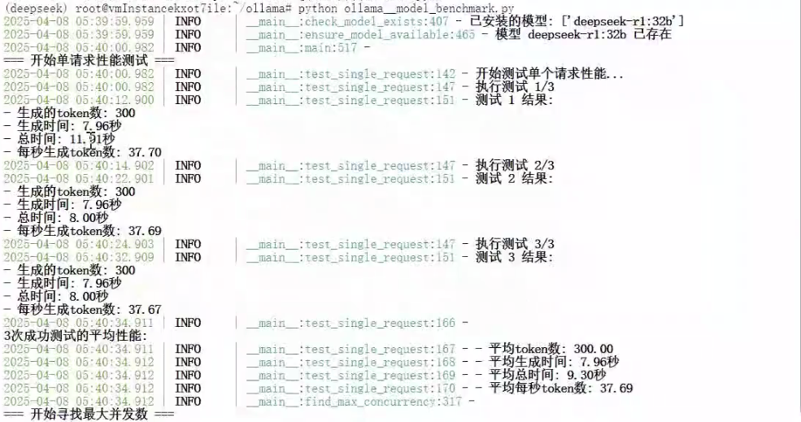
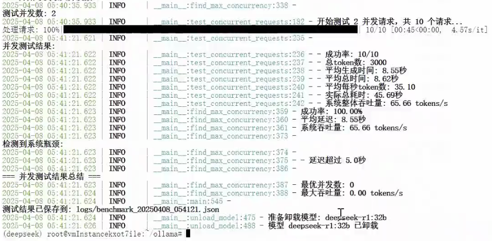

### 并发脚本开发总结

> 基于 `ollama__model_benchmark.py` 的实现整理，骨架可迁移至任意 OpenAI 兼容接口或 vLLM 服务。

#### 一、先定义清楚要测什么

写脚本之前，在文件头部用注释明确核心指标的定义：

- **吞吐量（Throughput）**：单位时间内处理的请求数或生成的 token 数，通常以 `tokens/秒` 衡量。Ollama 的响应自带 `eval_count`（生成 token 数）和 `eval_duration`（生成耗时纳秒数），直接取用即可，计算方式为 `eval_count / eval_duration`，不需要自己掐表统计 token。
- **并发（Concurrency）**：同时处理的请求数，表示系统的并行处理能力。关键认知：**并发会让单个请求变慢，但整体吞吐量上升**——这是后面"寻找最优并发数"的理论依据。

#### 二、控制变量，保证数据可比

压测最忌讳变量不齐，脚本做了三层控制：

1. **固定生成长度**：`options.num_predict=300` 限制每次生成同样多的 token，否则有的回答 50 token、有的 500 token，吞吐量数字没有可比性；
2. **固定采样参数**：`temperature=0.7` 统一写死；
3. **固定提示词池**：预置 25 个问题（科学、编程、数学、AI、哲学五类），每个请求用 `random.choice` 随机抽取，既覆盖多样性又保证总量可控。

#### 三、用 asyncio + aiohttp 搭异步压测骨架

这是脚本的主体技术选型：

- 用 `aiohttp.ClientSession` 发异步 HTTP 请求，调 Ollama 的 `/api/generate` 接口（`stream=False` 拿完整响应，方便读统计字段）；
- 单个请求封装成 `single_request()` 协程，**内部 try/except 兜底**——任何失败都返回 `{"success": False, "error": ...}` 而不是抛异常中断整个压测。压测脚本的基本素养：**单点失败不能炸全局**。

#### 四、用 Semaphore 精确控制并发数

并发测试的核心机制在 `test_concurrent_requests()`：

- `asyncio.Semaphore(concurrent_requests)` 是关键工具——它限制"同时在跑"的协程数量；
- 模式：创建**全部** `total_requests` 个任务，每个任务先 `async with sem` 排队，拿到信号量才真正发请求，请求完再 `sleep(0.5)` 留一点间隔；
- 用 `asyncio.gather(*tasks)` 等全部完成，配合 `tqdm` + `add_done_callback` 做实时进度条；
- 统计时区分两个口径：
  - **单请求平均吞吐**（`avg_tps`）
  - **系统整体吞吐**（`total_tokens / actual_time`）——后者才是衡量服务承载能力的指标。

#### 五、先测单请求基准，再逐步加压

流程上必须先有 baseline：`test_single_request()` 串行跑若干次（每次间隔 2 秒冷却），得到单请求的平均 token 数、延迟、吞吐。

基准的两个用途：

1. 知道模型"独占时"的性能上限；
2. 作为后面判断"并发把延迟拖到什么程度算不可接受"的参照。

#### 六、加一层系统健康检查作为"安全阀"

`check_system_health()` 每轮压测前后都会执行：

- 用 `psutil` 采 CPU 和内存使用率；
- 用 `subprocess` 调 `nvidia-smi` 采各 GPU 的显存占用；
- 阈值分级：

| 阈值 | 动作 |
|---|---|
| > 85% | 打 warning |
| > 90% | 判定不健康 |
| > 95% | 紧急停止测试 |

**压测的目的是摸极限而不是把机器打死**，所以要让脚本具备"感知到资源逼近极限就主动收手"的能力。

#### 七、自动寻找最大并发数

`find_max_concurrency()` 是整个脚本最有价值的部分，逻辑是一个"阶梯加压循环"：

1. 从 `start_concurrent=2` 开始，每轮 +1 并发，跑到 `max_concurrent` 为止；
2. 每轮之前先做健康检查，资源异常就等待 30 秒恢复或直接停止；
3. 每轮记录成功率、平均延迟、系统吞吐；
4. **最优并发数的判定标准是三条件同时满足**，缺一不可：
   - 成功率 ≥ 阈值（如 95%）
   - 延迟 ≤ 阈值（如 5 秒）
   - 吞吐量创新高
5. 一旦成功率跌破阈值或延迟超标，说明摸到瓶颈了，打印瓶颈原因并 `break`，不再往上加压；
6. 连续 2 轮全军覆没也直接停止，避免无意义的重试。

循环跑完输出两个数字：**最优并发数**和**最大吞吐量**，这正是容量规划最需要的结论。

#### 八、管好模型的生命周期

压测对象本身也要管理，main 前后各有一道：

- **测之前** `ensure_model_available()`：先查 `/api/tags` 看模型在不在，不在就调 `/api/pull` 自动下载（并解析流式进度）——保证脚本可重复跑、换机器也能跑；
- **测之后** `unload_model()`：发一个 `keep_alive=0` 的空请求，让 Ollama 立即把模型从显存/内存卸载，不留残留占用。清理放在 `try...finally` 里，保证测试中途报错也会执行。

#### 九、结果落盘，可追溯可复盘

- 把所有数据组装成结构化 JSON（测试时间戳、模型名、服务地址、单请求结果、并发测试全量数据），写到 `logs/benchmark_<时间戳>.json`；
- 日志用 loguru 写 `model-benchmark.log` 并按 20MB 轮转。

压测报告必须能存档对比，否则"这次 32b 模型最优并发是 4"这种结论下次就找不到了。

#### 十、main() 里编排整个流程

 - 确保模型可用 → 系统健康检查 → 单请求基准测试 → 阶梯并发测试找极限 → 保存 JSON 报告 → (finally) 卸载模型
 ```bash
    方法论总结
    **固定变量测基准 → 信号量控并发阶梯加压 → 每轮看"成功率 + 延迟 + 吞吐"三指标 → 资源健康检查兜底防炸机 → 摸到瓶颈即停 → 结果落盘。**
    这套骨架换成 OpenAI 兼容接口或 vLLM 服务同样适用，只需替换请求构造和指标解析那几行。
```

### 智能客服之模型压力测试-在线DeepSeek模型压力测试


> 基于 `simple-bench.py` 的实现整理，适用于 DeepSeek、通义、vLLM 服务等任意 OpenAI 兼容接口。

#### **一、明确定位：在线 API 压测与本地压测的差异**

- 压测对象是 OpenAI 兼容的在线服务，而不是本地推理进程，指标侧重因此不同：网络往返带来的**首 Token 延迟（TTFT）**成为核心指标，token 统计需在客户端完成；
- 驱动方式从“固定请求数”转向“**固定时长**”，更能模拟稳态负载；
- 技术选型：`openai.AsyncOpenAI`（官方异步客户端，天然支持流式）+ `asyncio` + `tiktoken` + `argparse`。

#### **二、用流式请求采集核心指标**

`send_request()` 单请求协程的设计要点：

1. `stream=True` 发起流式请求，逐 chunk 消费响应；
2. **第一个 chunk 到达的时刻即首 Token 延迟**（`first_token_latency`），这是衡量在线服务体验的关键指标；
3. 收到 `finish_reason` 即 `break`，不空等连接关闭；
4. 每个 chunk 用 `encoder.encode(delta.content)` 累计生成 token 数；
5. 整个协程用 try/except 兜底，失败返回 `success=False` 的字典——**单点失败不能炸全局**，与本地压测脚本同一素养。

注意事项：tokenizer 编码文件首次运行需联网下载；不同模型可能依赖不同编码（如 gpt-4o 用 `o200k_base`），通义千问可用 `dashscope.get_tokenizer`；粗略估算可用 `len(content.split())` 代替精确计数。

#### **三、压测驱动模型：固定时长 + 工人循环**

`run_load_test()` 的骨架：

- `asyncio.Semaphore(concurrency)` 控制同时在飞的请求数；
- 创建恰好 `concurrency` 个 worker 协程，每个 worker 在 `while time.time() - start_time < duration_seconds` 循环里持续发请求；
- 总请求数**动态统计**（`nonlocal` 计数器），而不是预先设定；
- 若要精确控制 QPS，可在循环尾加 `await asyncio.sleep(1/concurrency)`（脚本中被注释掉，说明默认是“不间歇压满”）。

#### **四、延迟统计必须有分位数，不能只看平均**

- 平均值会掩盖长尾，必须输出 **P90 / P95 / P99**；
- `calculate_percentile()` 用线性插值计算，注意边界处理：`upper = min(lower + 1, n - 1)`，否则单元素列表会索引越界（代码注释里明确记录了这个坑）；
- 同时输出最大/最小延迟和平均首字延迟，形成完整的延迟画像。

#### **五、吞吐量要区分两个口径**

- **单并发吞吐**：`tokens_generated / (total_latency - first_token_latency)`——扣掉首字等待，只衡量解码阶段的生成速度；
- **总体吞吐**：`total_tokens / 压测墙钟时间`——衡量服务整体承载能力；
- 隐患提示：脚本计算单并发吞吐时只判断了 `total_latency > 0`，未防 `total_latency == first_token_latency`（如请求零生成）的除零情况，健壮性上应补 `total_latency > first_token_latency` 的判断。

#### **六、CLI 参数设计支持矩阵压测**

`argparse` 参数设计思路：

- `--url` / `--model` / `--api_key` 必填，构成压测三元组；
- `--concurrencys` 支持逗号分隔多并发档位（如 `5,10`）；`--concurrency` 传单个值时优先，便于快速单轮测试；
- `--max_tokens` 支持逗号分隔多档（如 `100,1024,16384`），用于观察**生成长度对吞吐的影响**；
- `--duration_seconds` 控制每轮时长；
- payload 统一 `stream=True`、`temperature=0.1` 固定采样，保证可比性。

使用示例（摘自脚本文档字符串）：

    python simple-bench.py --url https://api.deepseek.com/v1 \
      --model deepseek-chat \
      --concurrencys 5,10 \
      --prompt "Introduce the history of China" \
      --max_tokens 100,1024 \
      --api_key sk-xxxx \
      --duration_seconds 30

#### **七、多轮编排与冷却间隔**

`run_with_max_token()` 的编排逻辑：

1. 外层遍历 `max_tokens` 档位，内层遍历并发档位，形成 **max_tokens × 并发** 的测试矩阵；
2. 每轮 `asyncio.run(run_load_test(...))` 独立起事件循环；
3. 轮与轮之间 `time.sleep(5)` 冷却，避免上一轮的余波（限流、排队）污染下一轮数据。

#### **八、结果输出为可对比的 Markdown 表**

- 每轮结果是一个指标字典，key 完全一致；
- 单轮结果按 `指标: 值` 逐行打印；
- 多轮汇总时构造“纵向表”：**行为指标、列为各并发档位**，一眼看出并发从 5 提到 10 后延迟与吞吐的变化趋势，可直接粘贴进文档。

#### **九、完整流程编排**

解析 CLI 参数 → 构造 api_config 与 payload → 按 max_tokens × 并发档位矩阵循环 → 每轮固定时长压测并收集指标 → 冷却 5 秒 → 汇总输出 Markdown 表。

#### **十、方法论总结**

**流式采集 TTFT 与 token 数 → 信号量控并发 + 固定时长驱动 → P90/P95/P99 分位数看长尾 → 单并发吞吐与总体吞吐分开看 → 多档位矩阵扫描 → 轮间冷却防污染 → 结果表格化落盘。**

与本地压测脚本（`ollama__model_benchmark.py`）对比记忆：本地版靠 Ollama 响应自带的 `eval_count/eval_duration` 拿指标、用固定请求数压；在线版拿不到服务端统计，只能**客户端流式自己数 token**、用固定时长压，并新增了首字延迟和分位数这两个对在线服务至关重要的维度。

#### 运行压测脚本 `simple-bench-to-api. py`

```bash
# simple-bench-to-api. py
import asyncio
import time
import argparse
from statistics import mean
from openai import AsyncOpenAI, APIConnectionError
import tiktoken

# 获取tokenizer对象，目前只支持通义千问系列模型
# from dashscope import get_tokenizer
# tokenizer = get_tokenizer('qwen-turbo')

"""
conda create --name bench python=3.11
conda activate bench

pip install openai
pip install tiktoken

python -u simple-bench-to-api.py --url https://api.deepseek.com/v1 \
  --model deepseek-chat \
  --concurrencys 5,10 \
  --prompt "Introduce the history of China" \
  --max_tokens 100,1024,16384 \
  --api_key sk-xxxxxxxxxxxxxxxxxxxxxxxxxxxxxxxx \
  --duration_seconds 30
"""

KEY_of_concurrency = "并发数"

# 这行会联网下载编码文件。且不同模型可能依赖不同编码（如gpt-4o使用o200k_base），需确保下载的编码文件与目标模型匹配。
encoder = tiktoken.get_encoding("cl100k_base")


async def send_request(client, payload):
    start_time = time.time()
    first_token_received = False
    first_token_latency = None
    tokens_generated = 0

    try:
        stream = await client.chat.completions.create(**payload)
        async for chunk in stream:
            if not first_token_received:  # 首Token到达
                first_token_latency = time.time() - start_time
                first_token_received = True
            if chunk.choices[0].finish_reason:
                break
            # 累计生成token数
            content = chunk.choices[0].delta.content or ""
            tokens_generated += len(encoder.encode(content))
            # 简单用 split() 代替
            # tokens_generated += len(content.split())
        return {
            "success": True,
            "first_token_latency": first_token_latency,
            "total_latency": time.time() - start_time,
            "tokens_generated": tokens_generated
        }
    except Exception as e:
        print(f"Unexpected error: {e}")
        return {
            "success": False,
            "first_token_latency": None,
            "total_latency": None,
            "tokens_generated": 0
        }

# 基于线性插值计算百分位数


def calculate_percentile(latencies, percentile):
    if not latencies:
        return 0
    sorted_latencies = sorted(latencies)
    n = len(sorted_latencies)
    index = (n-1) * percentile/100
    lower = int(index)
    # upper = lower + 1 # 会报错，因为 upper 可能超出索引范围
    upper = min(lower + 1, n - 1)  # 限制 upper 的最大值为 n-1
    weight = index - lower
    return sorted_latencies[lower]*(1-weight) + sorted_latencies[upper]*weight


# 固定时长持续发送请求
async def run_load_test(api_config, payload, concurrency, total_requests, duration_seconds=60):
    start_time = time.time()
    semaphore = asyncio.Semaphore(concurrency)
    client = AsyncOpenAI(**api_config)
    total_requests = 0  # 动态计数总请求数
    results = []

    async def worker():
        nonlocal total_requests
        while time.time() - start_time < duration_seconds:
            async with semaphore:
                result = await send_request(client, payload)
                results.append(result)  # 将结果添加到列表中
                total_requests += 1  # 每次请求后递增计数器
                # return result
            # await asyncio.sleep(1/concurrency)  # 控制QPS

    tasks = [asyncio.create_task(worker()) for _ in range(concurrency)]
    await asyncio.gather(*tasks, return_exceptions=True)

    # 过滤掉 None 值
    results = [r for r in results if r is not None]

    # 统计逻辑保持不变
    success_count = sum(1 for r in results if r["success"])
    success_rate = success_count / total_requests * 100

    # 提取各延迟指标
    success_results = [r for r in results if r["success"]]

    # 首Token延迟列表（仅成功请求）
    first_latencies = [r["first_token_latency"]
                       for r in success_results if r["first_token_latency"] is not None]

    # 总延迟列表（仅成功请求）
    total_latencies = [r["total_latency"]
                       for r in success_results if r["total_latency"] is not None]

    # 平均延迟
    avg_latency = mean(total_latencies) if total_latencies else 0

    # 计算统计量
    success_count = len(success_results)
    success_rate = success_count / total_requests * 100

    total_tokens = sum(r['tokens_generated'] for r in success_results)
    throughputs = [r['tokens_generated']/(r['total_latency']-r['first_token_latency'])
                   for r in success_results if r['total_latency'] > 0]

    return {
        KEY_of_concurrency: concurrency,
        "总请求数": total_requests,
        "成功率": f"{success_rate:.2f}%",
        "平均延迟": f"{avg_latency:.4f}s",
        "最大延迟": f"{max(total_latencies):.4f}s" if total_latencies else "0s",
        "最小延迟": f"{min(total_latencies):.4f}s" if total_latencies else "0s",
        "P90延迟": f"{calculate_percentile(total_latencies, 90):.4f}s",
        "P95延迟": f"{calculate_percentile(total_latencies, 95):.4f}s",
        "P99延迟": f"{calculate_percentile(total_latencies, 99):.4f}s",
        "平均首字延迟": f"{mean(first_latencies):.4f}s" if first_latencies else "N/A",
        "总生成tokens数": total_tokens,
        "单并发最小吞吐量": f"{(min(throughputs)):.2f} tokens/s",
        "单并发最大吞吐量": f"{(max(throughputs)):.2f} tokens/s",
        "单并发平均吞吐量": f"{(mean(throughputs)):.2f} tokens/s",
        "总体吞吐量": f"{(total_tokens/(time.time() - start_time)):.2f} tokens/s"
    }


def main():
    parser = argparse.ArgumentParser(description="OpenAI服务压测工具(v1.x)")
    parser.add_argument("--url", required=True,
                        help="API基础地址，例如：http://localhost:8000/v1")
    parser.add_argument("--model", required=True, help="模型名称")
    parser.add_argument("--concurrencys", required=False, help="逗号分隔的并发数")
    parser.add_argument("--concurrency", required=False,
                        type=int, help="并发数，如果设置了，则忽略concurrencys参数")
    parser.add_argument("--requests", type=int, default=10)
    parser.add_argument("--prompt", default="Once upon a time")
    parser.add_argument("--max_tokens", default="10")
    parser.add_argument("--api_key", required=True)
    parser.add_argument("--duration_seconds", type=int, default=60)
    args = parser.parse_args()

    api_config = {
        "base_url": args.url,
        "api_key": args.api_key,
        "default_headers": {"User-Agent": "LoadTestClient/1.0"}
    }

    payload = {
        "model": args.model,
        "messages": [{"role": "user", "content": args.prompt}],
        "stream": True,
        "max_tokens": args.max_tokens,
        "temperature": 0.1
    }

    if args.concurrency:
        # 执行压测
        metrics = asyncio.run(run_load_test(
            api_config, payload, args.concurrency, args.requests, args.duration_seconds
        ))

        # 输出结果
        print(f"\n压测结果：")
        for k, v in metrics.items():
            print(f"{k:<15}: {v}")
        return

    max_token_list = list(map(int, args.max_tokens.split(",")))
    concurrencys = list(map(int, args.concurrencys.split(",")))
    for max_tokens in max_token_list:
        print(
            f"\n\n===== 开始 max_tokens={max_tokens} 的 {args.concurrencys} 并发压测 =====\n")
        payload["max_tokens"] = max_tokens
        run_with_max_token(api_config, payload, args.requests,
                           concurrencys, args.duration_seconds)


def run_with_max_token(api_config, payload, requests, concurrencys, duration_seconds):
    # 多并发压测
    all_metrics = []
    for concurrency in concurrencys:
        print(f"\n----- 开始{concurrency}个并发压测 -----")
        metrics = asyncio.run(run_load_test(
            api_config, payload, concurrency, requests, duration_seconds
        ))
        all_metrics.append(metrics)

        print(f"\n--- {concurrency}个并发压测结果：")
        for k, v in metrics.items():
            print(f"{k:<15}: {v}")

        time.sleep(5)

    print(f"\n\n----- max_tokens={payload['max_tokens']} 压测结果汇总 -----\n")
    # 构造 Markdown 横向表（每个 metrics 字典的 key 一致）
    # headers = list(all_metrics[0].keys())
    # header_line = "| " + " | ".join(headers) + " |"
    # separator_line = "| " + " | ".join(["---"] * len(headers)) + " |"
    # rows = []
    # for metrics in all_metrics:
    #     row = "| " + " | ".join(str(metrics[h]) for h in headers) + " |"
    #     rows.append(row)

    # markdown_table = "\n".join([header_line, separator_line] + rows)
    # print(markdown_table)

    # 构造 Markdown 纵向表，KEY_of_concurrency 作为列标题
    concurrency_headers = [str(metrics[KEY_of_concurrency])
                           for metrics in all_metrics]
    header_line = "| 指标 \\ 并发数 | " + \
        "个并发 | ".join(concurrency_headers) + "个并发 |"
    separator_line = "| --- | " + \
        " | ".join(["---"] * len(concurrency_headers)) + " |"

    # 获取所有指标 key（每个 metrics 字典的 keys 都一致）
    metric_keys = list(all_metrics[0].keys())
    rows = []
    for key in metric_keys:
        if key == KEY_of_concurrency:
            continue
        # 每行的第一个单元格是指标名称，后续单元格是每个并发下该指标的数值
        row_values = [str(metrics[key]) for metrics in all_metrics]
        row = "| " + key + " | " + " | ".join(row_values) + " |"
        rows.append(row)

    markdown_table = "\n".join([header_line, separator_line] + rows)
    print(markdown_table)


if __name__ == "__main__":
    main()
```

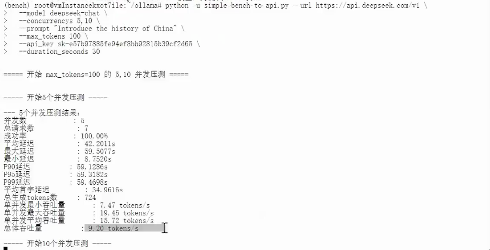


## 智能客服之模型部署-项目文件和功能展示
 **开发环境**
 - Pycharm

 **项目部署环境**
 https://www.autodl.com/

 **项目功能演示**
 - 功能表

| 功能项               |
|------------------------|
| 登录，注册         |
| 基于对话模型对话       |
| 基于私有模型对话               |
| 基于语义相似度缓存功能                    |
| 多用户功能                    |
| 联网搜索                    |


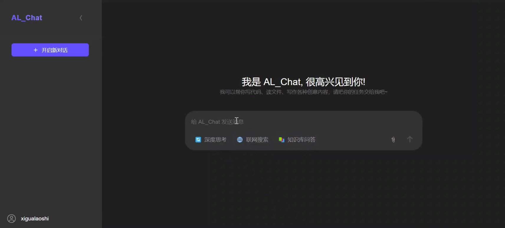

## 智能客服之模型部署-私有化模型部署
 - 租算力服务器


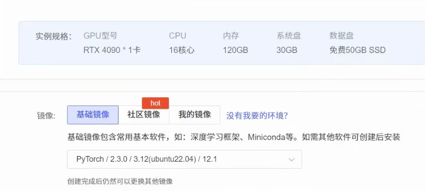

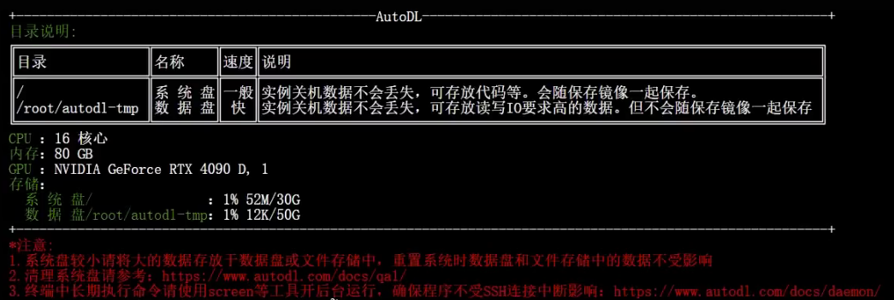
```bash
# 安装Ollama
curl -fsSL https://ollama.com/install.sh | sh
# 启动ollama
ollama serve
# 安装思考模型
ollama run deepseek-r1:1.5b
# 安装Embedding模型(处理高频问题进入Redis里面返回)
# Embedding 模型是将文本、图像等离散数据转换为连续高维向量的 AI 模型，让语义相似的内容在向量空间中距离更近。‌‌
ollama pull bge-m3
```
 - 安装Ollama
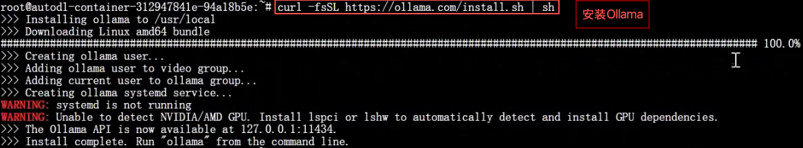
 - 启动ollama
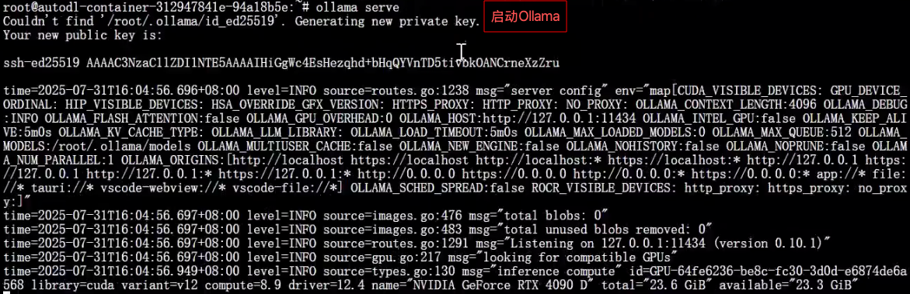
 - 安装思考模型 deepseek-r1:1.5b
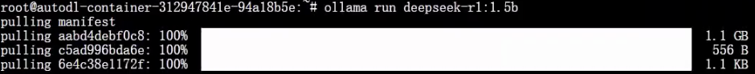
 - 安装Embedding模型 bge-m3
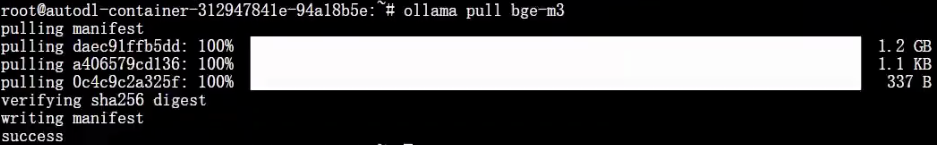

## 智能客服之模型部署-MySql数据库安装
 - 用于用户信息存储等
```bash
# 安装Mysql

# 更新系统软件包索引列表（从软件源拉取最新的包信息，不安装任何东西，为后面的安装做准备）
sudo apt-get update
# 安装 MySQL 数据库服务器（Ubuntu/Debian 系统命令）
sudo apt-get install mysql-server
# 启动 MySQL 服务（安装完默认没启动，必须先启动才能连接）
sudo service mysql start
# 首次登录：以 root 管理员身份连接 MySQL，回车后输入安装时设置的 root 密码
首次 mysql -u root -p 
 # 登录后第一件事：创建普通用户 gpt 并授权，例如：
 #   CREATE USER 'gpt'@'localhost' IDENTIFIED BY '你的密码';
 #   GRANT ALL PRIVILEGES ON *.* TO 'gpt'@'localhost';
 #   FLUSH PRIVILEGES;
# 下次登录：改用刚创建的 gpt 普通用户连接（生产环境不建议直接用 root 操作）
(下次登录输入mysql -u gpt -p)

# 创建账户 
CREATE USER 'gpt'@'localhost' IDENTIFIED BY 'gpt';
# 给账户赋权限
GRANT ALL PRIVILEGES ON *.* TO 'gpt'@'localhost';
FLUSH PRIVILEGES;
# 创建数据库
create database al_chat; 
```

## 智能客服之模型部署-Redis数据库安装
 - 用于高频信息存储缓存
```bash
# 下载Redis源码
apt-get install -y gcc make tcl wget
wget http://download.redis.io/releases/redis-7.0.4.tar.gz
tar -zxvf redis-7.0.4.tar.gz

# 编译源码
cd redis-7.0.4
cd deps; make -j4 hiredis jemalloc linenoise lua
cd ..   # 回到redis源码目录
make install  # 安装redis
make clean  # 清理编译文件

# 修改配置文件
cd src
vi ../redis.conf #修改redis数据密码为gpt
1. bind：指定Redis的监听地址，默认是`127.0.0.1`，如果需要监听所有地址，则可以设置为`0.0.0.0`。比如大家使用云服务器部署Redis，想要在自己的`IP`地址上进行访问，则可以设置为`0.0.0.0`，否则会无法访问到`Redis`服务。

2. port：指定Redis的监听端口号，默认是`6379`。如果大家想要修改端口号，则可以设置为其他端口号。

3. requirepass：指定Redis的密码，默认是`""`，如果大家想要设置密码，则可以设置为其他密码。

# 启动redis
redis-server ../redis.conf 

```
- 测试redis
```bash
! pip install redis

import redis

r = redis.Redis(host='localhost', password='gpt',port=6379, db=0)

# 增：添加数据
def add_data(key, value):
    r.set(key, value)           # set：设置键值对
    print(f"添加数据: {key} -> {value}")

# 查：获取数据
def get_data(key):
    value = r.get(key)         # get：获取键值对
    if value is not None:
        print(f"获取数据: {key} -> {value.decode('utf-8')}")
    else:
        print(f"键 {key} 不存在")
        
# 添加数据
add_data("name", "wuyanzu")
add_data("age", "30")
```


## 智能客服之模型部署-项目启动与功能测试

```bash
步骤1：创建项目虚拟环境
conda create --name al_chat_0.1 python==3.11
conda activate al_chat_0.1
步骤2：安装依赖
pip install -r requirements.txt
步骤3：配置 .env文件
    配置在线模型信息
    配置离线模型信息
    配置embedding模型信息
    配置数据库信息
    配置redis数据库信息
步骤4：初始化数据库表
python ./scripts/init_db.py
步骤5：启动项目
python run.py
```
- 创建项目虚拟环境
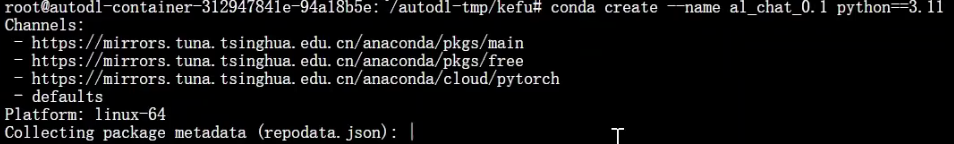

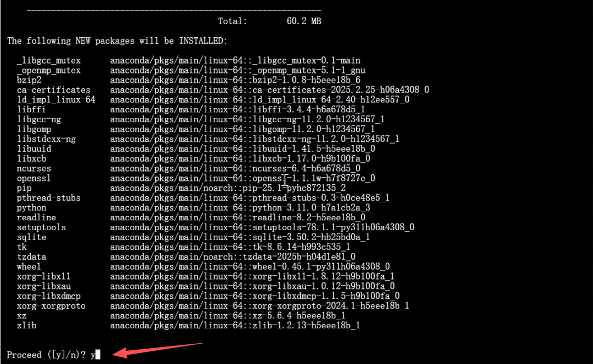

- 激活项目
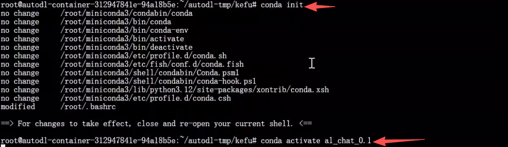


 - 安装依赖
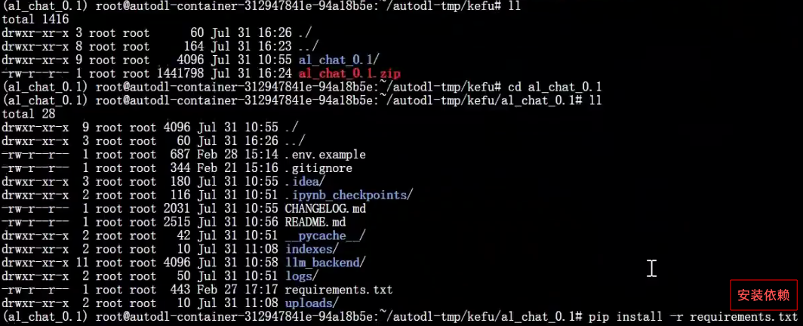

 - 配置 .env文件
 - 申请 `https://api-docs.deepseek.com/zh-cn/` key

```bash
# LLM 服务配置 (deepseek 或 ollama)
CHAT_SERVICE=deepseek    # 通用对话服务选择
REASON_SERVICE=ollama    # 深度思考服务选择

# DeepSeek 配置
DEEPSEEK_API_KEY=sk-xxxxxxxxxxxxxxxxxxxxxxxxxxxxxxxx
DEEPSEEK_BASE_URL=https://api.deepseek.com/v1/
DEEPSEEK_MODEL=deepseek-chat    # 通用对话模型

# Ollama 配置
OLLAMA_BASE_URL=http://localhost:11434
OLLAMA_CHAT_MODEL=qwen2.5:1.5b            # 通用对话模型
OLLAMA_REASON_MODEL=deepseek-r1:1.5b       # 深度思考模型
OLLAMA_EMBEDDING_MODEL=bge-m3

# SerpAPI 配置 (联网搜索增强) , 注册地址：https://serpapi.com/
SERPAPI_KEY=xxxxxxxxxxxxxxxxxxxxxxxxxxxxxxxxxxxxxxxxxxxxxxxxxxxxxxxxxx

DB_HOST=localhost
DB_PORT=3306
DB_USER=gpt
DB_PASSWORD=gpt   # 数据库密码
DB_NAME=al_chat


# Search settings 搜索返回结果数量
SEARCH_RESULT_COUNT=10


# Redis settings
REDIS_HOST=localhost
REDIS_PORT=6379
REDIS_DB=0
REDIS_PASSWORD=gpt
REDIS_CACHE_EXPIRE=3600 # 缓存失效时间，单位秒
REDIS_CACHE_THRESHOLD=0.9 # 缓存命中率阈值，单位0-1之间
```
 - 初始化数据库表
  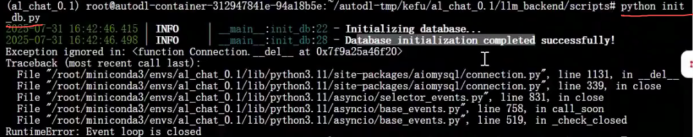
 
  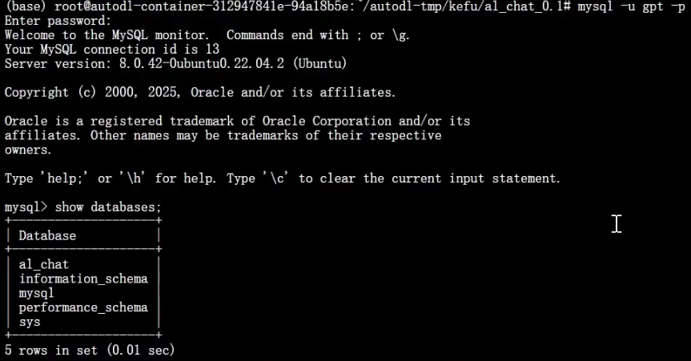

  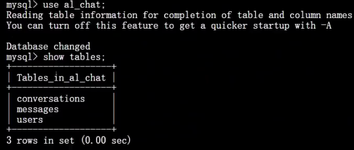

 - 启动项目
 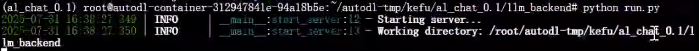

 - 本地访问方式，建立ssh隧道
 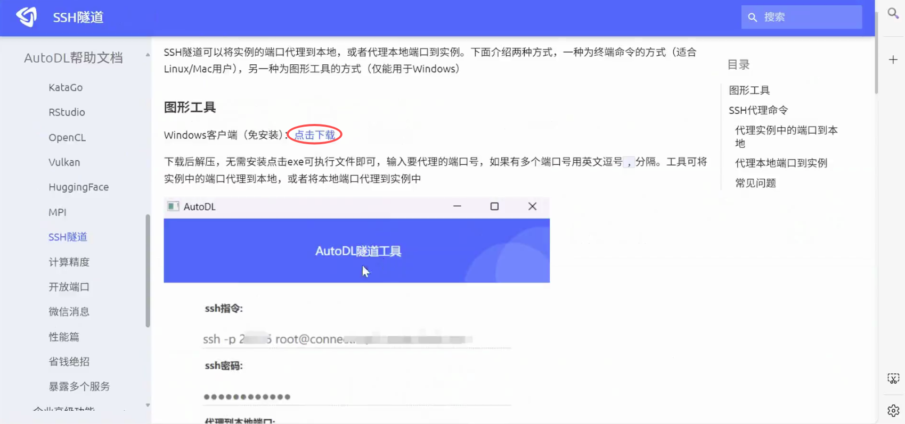
 - 复制服务器 登录地址和密码
 
 - 配置代理
 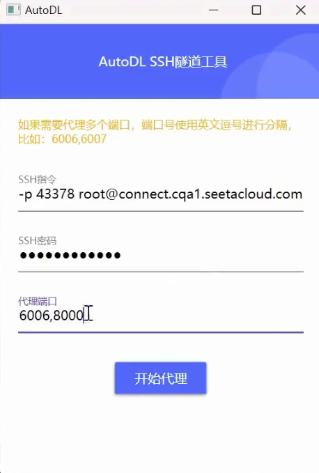
 - 访问代理
 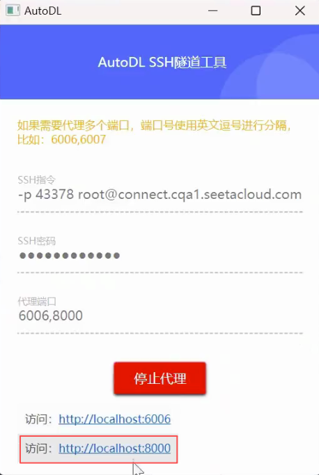

## 智能客服之技术方案-技术方案前后端分离

### FastAPI前后端分析
 >`FastAPI`是一个开源项目，其作用是基于标准 `Python` 类型提示使用 `Python` 构建 `REST API`，使用 ASGI 的标准来构建 `Python Web` 框架和服务器。所有简单理解：`FastAPI` 是一个 `ASGI Web` 框架。官方Github：https://github.com/fastapi/fastapi


 **对`FastAPI`的两个概念理解**
 - 1. 它可以把一个`Python`函数，封装成一个`REST API`接口，并提供给前端调用。类似于 /api/generate 接口。
 - 2. 它是一个`ASGI Web`框架，可以构建`Python Web`框架和服务器，解决前端和后端之间的通信问题。也就是可以让前端通过`URL`地址来访问后端服务，并根据请求的参数来执行对应的后端服务，并且前端还可以获取到后端服务的返回结果。

 **几个流行的基于ASGI的Web框架包括：**
 - 1. Starlette：一个轻量级的ASGI框架，它旨在成为构建高性能异步服务的基础框架。Starlette 可以独立使用，也可以作为其他框架的基础组件。
 - 2. FastAPI：建立在Starlette之上的一个现代、快速（高性能）的Web框架，用于构建API。FastAPI强调快速开发、类型安全和自动API文档生成。
 - 3. Uvicorn：一个轻量级、超快的ASGI服务器，常用于运行ASGI应用。虽然Uvicorn自身不是一个Web框架，但它是运行基于ASGI的框架（如Starlette和FastAPI）的推荐服务器。
  简单理解：`ASGI`框架（`FastAPI` 和 `Starlette`）负责定义应用程序的逻辑和结构，服务器（`Uvicorn`）负责处理网络请求和响应。其中，`Uvicorn` 是 `FastAPI` 的默认服务器。

**接下来，我们通过一个示例，来介绍如何使用FastAPI来构建一个REST API接口。**
- 下载 fastapi 依赖包
  使用 `pip install fastapi` 命令下载 `fastapi` 依赖包。
- 安装 uvicorn 依赖包
  接下来，我们需要使用一个 `ASGI` 服务器来运行 FastAPI 应用程序。这里我们使用 `Uvicorn` 作为 `ASGI` 服务器。需要使用 `pip install uvicorn` 命令下载 `uvicorn` 依赖包。
- 创建一个 `FastAPI` 应用程序
  创建一个 `FastAPI` 应用程序，并使用 `Uvicorn` 作为 `ASGI` 服务器来运行。这里需要说明的是，`jupyter notebook` 中是无法直接运行 `FastAPI` 应用程序的，需要使用 `Uvicorn` 作为 `ASGI` 服务器来运行。 因此，我们在`test_fastapi.py`文件中，来创建一个 `FastAPI` 应用程序，并使用 `Uvicorn` 作为 `ASGI` 服务器来运行。代码如下:

```bash
from fastapi import FastAPI
from pydantic import BaseModel

    app = FastAPI()  # 创建 FastAPI 应用实例
    class Item(BaseModel):
        name: str  # 项目的名称
        description: str = None  # 项目的描述，默认为 None
    @app.get("/")  # 定义 GET 请求的根路径
    async def read_root():
        """返回欢迎消息"""
        return {"message": "Hello, World"}
    @app.post("/items/")  # 定义 POST 请求的 /items 路径
    async def create_item(item: Item):
        """创建一个新项目并返回其数据"""
        return item  # 返回创建的项目数据
```

- 启动项目
  在`test_fastapi.py`文件中，我们创建了一个 `FastAPI` 应用程序，并使用 `Uvicorn` 作为 `ASGI` 服务器来运行。接下来，我们启动项目，并访问 http://127.0.0.1:8000/items/ 地址，来访问 FastAPI 应用程序。启动命令如下：
```bash
uvicorn test_fastapi:app --reload
```

启动项目后，根据代码中定义的请求，当通过localhost:8000/ 地址访问时，会调用`read_root`函数，返回`Hello, Worl`d消息。
 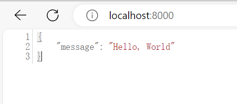

而当通过`localhost:8000/items/` 地址访问时，会调用`create_item`函数，返回创建的项目数据。但是这里需要注意到是：`POST` 请求是无法在浏览器的地址栏中直接访问的，因为`POST` 请求需要发送请求体，而浏览器地址栏无法发送请求体。所有我们需要使用 `curl` 命令或者 `Postman` 工具来访问。
 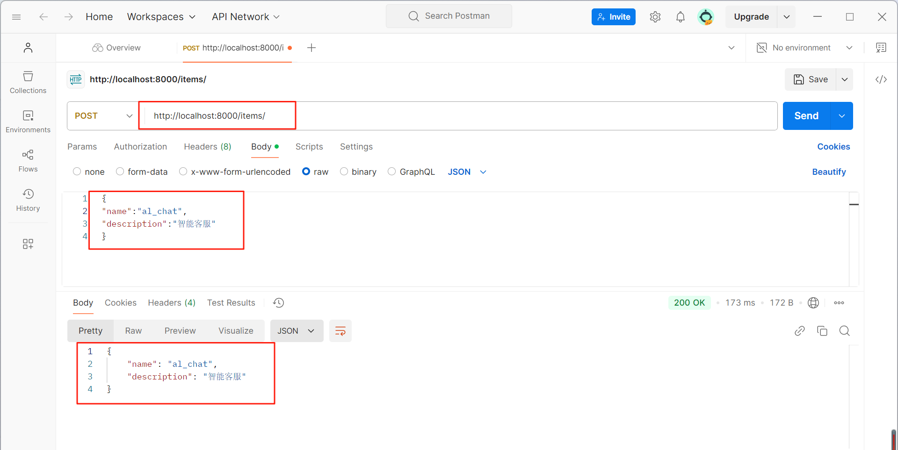

## 智能客服之技术方案-缓存语义相似度方案

### 一、要解决的问题

智能客服场景中大量用户问题高度重复（如"退货流程是什么 / 我怎么进行退货 / 怎么退货"），字面不同但语义相同。若每个问题都走完整的 **向量化 → 知识库查询 → 大模型加工** 流程：

- 知识库查询和大模型加工这两个环节都非常耗时（见架构图中红色标注）；
- 响应慢、体验差，消耗不必要的算力资源；
- 难以支撑高并发、高性能。

**解决思路**：语义相同的问题答案也相同，让"重复语义"直接命中缓存，跳过 LLM/RAG 全流程。
 - 未使用语义相似度缓存时
 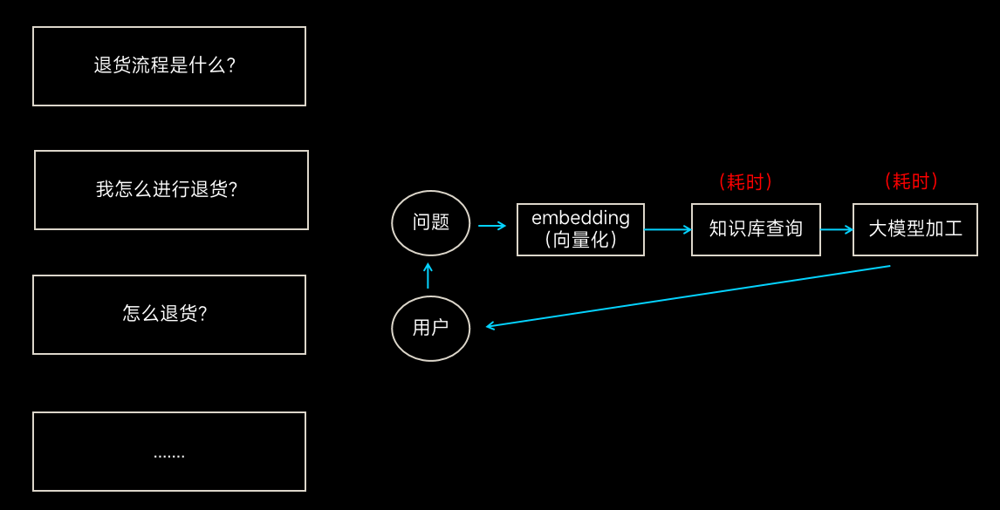
 - 使用了语义相似度缓存时
 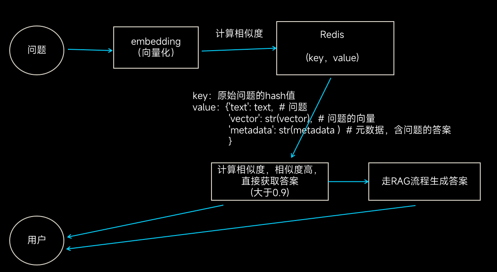

### 二、方案整体架构

```
                      ┌── 相似度 ≥ 0.9 ──▶ 直接从 Redis 取历史答案返回（cache 命中）
问题 ──▶ embedding ──▶ 遍历 Redis 缓存计算余弦相似度
                      └── 相似度 < 0.9 ──▶ 走 LLM / RAG 生成答案 ──▶ 写回 Redis ──▶ 返回（llm 来源）
```

第一遍问题必然未命中（缓存为空），走完整流程拿到答案后，把 **问题文本 + 问题向量 + 答案** 存入 Redis；此后语义相近的问题即可直接命中。

### 三、Redis 数据结构设计（核心）

- **Key**：`前缀 + 原始问题的 MD5 哈希`，如 `cache:30d24988981bb0308b93673cb522fc9d`。Key 无业务含义，只为保证数据独一无二；用哈希而非原文做 key 更省空间、查找更快、避免特殊字符和超长文本问题。
- **Value**：一个 Hash（哈希表），存三个字段：

```python
{
    'text': text,              # 原始问题文本
    'vector': str(vector),     # 问题的 embedding 向量（序列化成字符串存储）
    'metadata': str(metadata)  # 元数据，自由扩展，核心是存问题的答案 answer
}
```

- **前缀 `cache:`** 用于命名空间隔离，方便按模式批量扫描和清理。

### 四、实现步骤（对应代码四个 Step）

#### Step 1：基础依赖

```python
import numpy as np        # 向量运算（点积、模长）
import redis              # Redis 客户端
import requests           # 调用 Ollama HTTP 接口
import hashlib            # MD5 生成 key
```

#### Step 2：封装 Embedding 能力（OllamaEmbedding 类）

- 调用 Ollama 的 `/api/embed` 接口，模型用 `bge-m3`（输出 1024 维向量）；
- `embed_query(text)`：单文本转向量，返回 `result["embeddings"][0]`；
- `embed_documents(texts)`：批量转向量，直接返回整个 embeddings 列表；
- 需要 `raise_for_status()` 检查请求状态，异常时兜底返回空列表。

#### Step 3：Redis 缓存基础操作（RedisSemanticCache 类）

| 方法 | 作用 | 用的 Redis 命令 |
|---|---|---|
| `_create_key(text)` | `prefix + MD5(文本)` 生成确定性 key | — |
| `add_text(text, metadata)` | 向量化 → 组装三字段 → 写入缓存 | `hset(key, mapping=data)` |
| `get_text(key)` | 读取某个 key 的全部字段 | `hgetall(key)` |
| `list_all_keys()` | 按前缀列出所有缓存 key | `keys(prefix*)` |
| `get_by_text(text)` | 按原文精确查询（MD5 反查） | `hgetall` |
| `get_all_texts()` | 遍历所有 key 取全部数据 | `keys + hgetall` |
| `clear_all_cache()` | 按前缀清空缓存 | `keys + delete` |

注意：Python 的 `hash()` 每次进程启动结果不同，**必须用 MD5** 才能生成跨进程稳定的确定性 key。

#### Step 4：相似度搜索（SemanticCache 类，继承上者）

核心是余弦相似度 + 阈值过滤：

```python
def cosine_similarity(vec1, vec2):
    vec1, vec2 = np.array(vec1), np.array(vec2)
    return np.dot(vec1, vec2) / (np.linalg.norm(vec1) * np.linalg.norm(vec2))
```

`similarity_search(query, threshold=0.8)` 流程：

1. 对查询问题做 embedding；
2. `keys(prefix*)` 遍历所有缓存条目；
3. 逐条把存储的 vector 字符串 `eval` 还原为列表，计算余弦相似度；
4. 相似度 ≥ threshold 的条目收集为 `{text, similarity, metadata}`；
5. 按相似度**降序排序**返回。

**阈值选择**：课程强调要严谨，用 **0.9 或 0.95 以上** 才认定是"同一个问题"，0.7/0.8 容易误命中。

### 五、业务整合：带缓存的问答（OllamaChat 类）

`get_answer_with_cache(question, similarity_threshold=0.90)` 是完整的业务闭环：

```
1. query 向量化
2. 遍历 Redis 所有缓存，逐条算相似度，追踪最大相似度
3. 若 max_similarity ≥ 0.9 → 命中缓存，直接返回 metadata 里的 answer
   返回 {answer, source: 'cache', similarity, original_question}
4. 若未命中 → 调 Ollama /api/chat 生成答案
5. 把 (问题, 向量, {answer, source: 'llm'}) 写回 Redis
   返回 {answer, source: 'llm', similarity: 0, original_question: None}
```

设计亮点：返回值带 `source` 字段区分答案来自缓存还是大模型，方便验证和统计命中率。

### 六、实测效果验证

| 第一次提问 | 第二次提问 | 结果 |
|---|---|---|
| 什么是大模型？（写入缓存） | 大模型是什么？ | 相似度 **0.990**，直接命中 |
| 请介绍一下大模型 | 介绍一下大模型 | source = **cache** |
| 如何理解大模型？ | 什么是大模型？ | source = **cache** |
| hello | hello! | source = **cache** |

同一轮测试中未命中时 source = llm，且新问答对立即写入缓存供后续命中。方案优势：Redis 数据全在内存，读写快、可支撑高并发，性能远高于重新走一遍 LLM/RAG 流程。

### 七、工程化改进方向（回归 AL_Chat 项目）

结尾指出落地到真实项目还需补四件事：

1. **用户隔离**：把用户 ID 加进缓存前缀（如 `cache:{user_id}:md5`），避免 A 用户的答案串给 B 用户；
2. **元数据增强**：metadata 里追加访问时间、访问次数等统计字段；
3. **自动清理机制**：不能让缓存无限增长；
4. **淘汰策略**：定期检查缓存大小，超过上限时删除最久未访问的数据（LRU 思想）。

### 八、方案的边界与注意事项

- **遍历是 O(n)**：`similarity_search` 逐条 `keys()` + `hgetall()`，缓存条目多了会慢。生产级方案应换用 Redis 的向量搜索模块（RediSearch）或专用向量库，本方案胜在零额外依赖、逻辑清晰，适合中小规模或学习；
- **`eval` 有安全隐患**：代码用 `eval` 把字符串还原为向量/元数据，生产环境应改用 `json.loads`；
- **答案有时效性**：退货政策这类答案若更新，缓存里的旧答案需靠清理机制失效；
- **embedding 模型要一致**：写入和查询必须用同一个模型（bge-m3），否则向量空间不同，相似度无意义。

### 基于语义相似度缓存方案的实现

#### 1. Ollama 使用 OpenAI 兼容的 Embedding 模型接口

&emsp;&emsp;`Ollama`启动的`Embedding REST API` 同样是兼容了`OpenAI` 的接口规范，因此也可以用如下方式进行调用：
```bash
# 安装Openai SDK，因为需要通过openai的格式访问大模型
pip install openai
# 安装Redis的依赖
pip install redis
```

#### 2. 动态 Redis 缓存检索实现完整流程

- Step 1 ：基础设置和依赖导入
```bash
import numpy as np
from typing import List
import redis
import requests
import hashlib
```

- Step 2：实现基础的 Embedding 功能
&emsp;&emsp;这里我们实现一个文本 `Embedding` 类，通过 `Ollama` 的 `/api/embed` 的 `REST API` 接口，将输入文本转换为向量。代码如下：

```bash
class OllamaEmbedding:
    # 使用Ollama的原生API进行访问向量化模型
    def __init__(self, base_url: str = "http://localhost:11434", model: str = "bge-m3"):
        """初始化 Ollama Embedding
        
        Args:
            base_url: Ollama 服务地址
            model: 使用的模型名称
        """
        self.base_url = base_url.rstrip('/') # Ollama默认的地址和端口
        self.model = model # 访问的模型名称
        self.api_url = f"{self.base_url}/api/embed" # 请求
    # 传入文字 生成一个向量
    def embed_query(self, text: str) -> List[float]:
        """单个文本转换为向量
        
        Args:
            text: 输入文本
            
        Returns:
            List[float]: 向量表示
        """
        payload = {
            "model": self.model,
            "input": text
        }
        
        try:
            # 传进模型名字和用户的问题 
            response = requests.post(self.api_url, json=payload)
            response.raise_for_status()  # 检查请求是否成功
            result = response.json()
            return result["embeddings"][0]  # 返回第一个（也是唯一的）embedding
        except Exception as e:
            print(f"Error generating embedding: {e}")
            return []
    
    def embed_documents(self, texts: List[str]) -> List[List[float]]:
        """多个文本转换为向量
        
        Args:
            texts: 输入文本列表
            
        Returns:
            List[List[float]]: 向量表示列表
        """
        payload = {
            "model": self.model,
            "input": texts
        }
        
        try:
            response = requests.post(self.api_url, json=payload)
            response.raise_for_status() # 检查请求是否成功
            result = response.json()
            return result["embeddings"]   # 批量的话这里直接返回列表
        except Exception as e:
            print(f"Error generating embeddings: {e}")
            return []
```
&emsp;&emsp;接下来进行测试，其中需要重点关注的是：要根据自己的实际情况，修改 `base_url` 和 `model` 参数。

```bash
# 初始化 embedding 模型
embedding = OllamaEmbedding(
    base_url="http://localhost:11434",  # 根据自己的实际情况调整 endpoint 
    model="bge-m3"         # 根据自己的实际情况调整模型名称
)

# 测试单个文本
test_text = "请问如何理解大模型技术？"
single_vector = embedding.embed_query(test_text)
print("\n单个文本测试:")
print(f"输入文本: {test_text}")
print(f"向量维度: {len(single_vector)}")
print(f"向量示例: {single_vector[:5]}...")  # 只显示前5个数

# 测试多个文本
test_texts = [
    "什么是大模型？",
    "什么是深度学习？",
    "计算机是如何模拟人类思维的？",
    "你好，请你详细的介绍一下你自己"
]
vectors = embedding.embed_documents(test_texts)
print("\n多个文本测试:")
print(f"输入文本数量: {len(test_texts)}")
print(f"生成向量数量: {len(vectors)}")
print(f"每个向量维度: {len(vectors[0])}")
print(f"第一个向量示例: {vectors[0][:5]}...")  # 只显示第一个向量的前5个数
```

```
单个文本测试:
输入文本: 请问如何理解大模型技术？
向量维度: 1024
向量示例: [-0.041491773, -0.043265153, -0.044860397, -0.010097489, 0.004685496]...

多个文本测试:
输入文本数量: 4
生成向量数量: 4
每个向量维度: 1024
第一个向量示例: [-0.029511854, -0.038348723, -0.04801079, -0.01996431, 0.0013081663]...
```
- Step 3：实现 Redis 连接和基本操作

```bash
class RedisSemanticCache:
    def __init__(self, embedding_model, prefix: str = "cache:", 
                 host='localhost', password=None,port=6379, db=0):
        """初始化 Redis 缓存
        
        Args:
            embedding_model: 嵌入模型
            prefix: 键前缀
            host: Redis 主机地址
            port: Redis 端口
            db: Redis 数据库号
        """
        self.redis_client = redis.Redis(
            host=host,
            port=port,
            db=db,
            password=password
        )
        self.embedding = embedding_model
        self.prefix = prefix # 存一个前缀，为了区分不同用户，区分不同数据
        
    def _create_key(self, text: str) -> str:
        """使用 MD5 创建确定性的 key
        
        Args:
            text: 输入文本
            
        Returns:
            str: 格式为 "prefix:md5hash" 的 key
        """
        # 将文本转换为 MD5 哈希
        # 1. hash() 函数可以将任意长度的文本转换为一个固定长度的整数
        # 2. 相同的文本会生成相同的哈希值，不同的文本很大概率会生成不同的哈希值
        # 3. 使用哈希值作为 key 比直接使用原文本更节省空间
        # 4. Redis key 的查找会更快
        # 5. 避免原始文本中的特殊字符可能导致的问题
        # 6. 防止文本过长超出 Redis key 的长度限制
        md5_hash = hashlib.md5(text.encode('utf-8')).hexdigest()
        return f"{self.prefix}{md5_hash}"  # 前缀（prefix）可以用于命名空间隔离
    # 往Redis里面存入数据
    def add_text(self, text: str, metadata: dict = None):
        # 生成embedding
        vector = self.embedding.embed_query(text)
        key = self._create_key(text)
        
        # 存储数据
        data = {
            'text': text,  # 存储原始文本
            'vector': str(vector),  # 存储向量
            'metadata': str(metadata or {})  # 存储元数据
        }

        # hset：用于将多个字段-值对存储到哈希表 key 中
        self.redis_client.hset(key, mapping=data) 
        
    def get_text(self, key: str) -> dict:
        # hgetall：获取哈希表中所有字段-值对
        return self.redis_client.hgetall(key)
    
    def list_all_keys(self):
        """列出所有缓存的 keys"""
        pattern = f"{self.prefix}*"
        return [key.decode() for key in self.redis_client.keys(pattern)]

    def get_by_text(self, text: str):
        """通过原始文本查询"""
        key = self._create_key(text)
        result = self.redis_client.hgetall(key)
        if result:
            return {k.decode(): v.decode() for k, v in result.items()}
        return None

    def get_all_texts(self):
        """获取所有存储的文本数据"""
        all_data = []
        for key in self.list_all_keys():
            data = self.redis_client.hgetall(key)
            if data:
                all_data.append({k.decode(): v.decode() for k, v in data.items()})
        return all_data
    
    def clear_all_cache(self):
        """清除所有缓存数据"""
        pattern = f"{self.prefix}*"
        keys = self.redis_client.keys(pattern)
        if keys:
            self.redis_client.delete(*keys)
            print(f"已清除 {len(keys)} 条缓存记录")
        else:
            print("缓存为空")
```

&emsp;&emsp;接下来进行`Embedding`服务和`Redis`客户端的实例化，代码如下：

```bash
# 初始化 embedding 模型
embedding = OllamaEmbedding(
    base_url="http://localhost:11434",  # 根据自己的实际情况调整 endpoint 
    model="bge-m3"         # 根据自己的实际情况调整模型名称
)

# 初始化 Redis 缓存
redis_cache = RedisSemanticCache(
    host='localhost',  # 根据自己的实际情况调整 host
    password='gpt',  # 根据自己的实际情况调整 password
    port=6379,  # 根据自己的实际情况调整 port
    db=0,  # 根据自己的实际情况调整 db
    embedding_model=embedding
)
```

&emsp;&emsp;进行功能测试：

```bash
# 测试添加文本
test_text = "大模型是什么？"
redis_cache.add_text(test_text, metadata={"source": "test"})
```

```bash
# 测试其他功能

# 查看所有存储的数据
print("所有缓存的 keys:")
print(redis_cache.list_all_keys())

print("\n通过文本查询:")
result = redis_cache.get_by_text("我是吴彦祖")
print(result)

print("\n所有存储的数据:")
all_data = redis_cache.get_all_texts()
for item in all_data:
    print("\n---")
    print(f"文本: {item['text']}")
    print(f"元数据: {item['metadata']}")
    print(f"向量前5个值: {eval(item['vector'])[:5]}")  # 只显示向量的前5个值
```

```
所有缓存的 keys:
['cache:30d24988981bb0308b93673cb522fc9d']

通过文本查询:
None

所有存储的数据:

---
文本: 大模型是什么？
元数据: {'source': 'test'}
向量前5个值: [-0.023516722, -0.03535191, -0.051965814, -0.022367971, 9.404179e-05]
```

- Step 4：实现相似度搜索

```bash
# 计算余弦相似度
def cosine_similarity(vec1: List[float], vec2: List[float]) -> float:
    vec1 = np.array(vec1)
    vec2 = np.array(vec2)
    return np.dot(vec1, vec2) / (np.linalg.norm(vec1) * np.linalg.norm(vec2))
# 相似度查询
class SemanticCache(RedisSemanticCache):
    # threshold 相似度阈值
    def similarity_search(self, query: str, threshold: float = 0.8) -> List[dict]:
        # 获取查询文本的embedding
        query_vector = self.embedding.embed_query(query)
        
        # 获取所有缓存的数据
        results = []
        for key in self.redis_client.keys(f"{self.prefix}*"):
            cached_data = self.get_text(key)
            if not cached_data:
                continue
                
            # 计算相似度
            cached_vector = eval(cached_data[b'vector'])  # 将字符串转回列表
            similarity = cosine_similarity(query_vector, cached_vector)
            
            if similarity >= threshold:
                results.append({
                    'text': cached_data[b'text'].decode(),
                    'similarity': similarity,
                    'metadata': eval(cached_data[b'metadata'].decode())
                })
        
        return sorted(results, key=lambda x: x['similarity'], reverse=True)
```

&emsp;&emsp;进行语义相似度功能测试。代码如下：

```bash
# 测试
semantic_cache = SemanticCache(
    host='localhost',  # 根据自己的实际情况调整 host
    password='gpt',  # 根据自己的实际情况调整 password
    port=6379,  # 根据自己的实际情况调整 port
    db=0,  # 根据自己的实际情况调整 db
    embedding_model=embedding
)


# 测试相似度搜索
query = "什么是大模型？"
results = semantic_cache.similarity_search(query, threshold=0.90)
print("\n搜索结果:")
for result in results:
    print(f"文本: {result['text']}")
    print(f"相似度: {result['similarity']:.3f}")
    print(f"元数据: {result['metadata']}\n")
```

```
搜索结果:
文本: 大模型是什么？
相似度: 0.990
元数据: {'source': 'test'}
```

```bash
all_data = redis_cache.get_all_texts()
for item in all_data:
    print("\n---")
    print(f"文本: {item['text']}")
    print(f"元数据: {item['metadata']}")
    print(f"向量前5个值: {eval(item['vector'])[:5]}")  # 只显示向量的前5个值
```

```
---
文本: 大模型是什么？
元数据: {'source': 'test'}
向量前5个值: [-0.023516722, -0.03535191, -0.051965814, -0.022367971, 9.404179e-05]
```

&emsp;&emsp;通过上述代码，我们可以看到，当查询文本为`"大模型是什么？"`时，搜索结果为`"请问什么是大模型？"`，并且相似度为`0.95`，所以我们现在实现了对用户输入问题的基于语义的缓存搜索。

&emsp;&emsp;现在回归到实际的业务场景中，`Prompt Cache` 的应用逻辑应该是这样的：

1. 当用户输入问题时，先根据用户输入的问题，去缓存中搜索，如果缓存命中（即相似度大于某个阈值），则直接返回缓存中的答案。

2. 如果缓存没有命中，则根据用户输入的问题，执行大模型服务调用（API）逻辑，并在得到问答的结果后，将结果存入缓存中。

3. 以此类推，当用户再次输入相同的问题时，由于缓存中已经存在了该问题的答案，所以可以直接从缓存中返回答案，从而提高回答的效率。

&emsp;&emsp;现在我们就可以根据上述的逻辑，来进行优化，思路如下：

- 实现 OllamaChat 类 构建大模型服务调用（API）逻辑

```bash
class OllamaChat:
    def __init__(self, 
                 base_url: str = "http://localhost:11434", 
                 model: str = "deepseek-r1:1.5b",
                 redis_cache = None,
                 embedding = None):
        self.base_url = base_url.rstrip('/')
        self.model = model
        self.chat_url = f"{self.base_url}/api/chat"
        self.redis_cache = redis_cache
        self.embedding = embedding
    
    def get_answer_with_cache(self, question: str, similarity_threshold: float = 0.90) -> dict:
        """获取答案（优先从缓存中获取）
        
        Args:
            question: 用户问题
            similarity_threshold: 相似度阈值，超过这个值就使用缓存的答案
        """
        # 获取问题的向量
        query_vector = self.embedding.embed_query(question)
        
        # 搜索最相似的问题
        max_similarity = 0
        cached_answer = None
        
        # 遍历所有缓存
        for key in self.redis_cache.list_all_keys():
            data = self.redis_cache.redis_client.hgetall(key)
            if not data:
                continue
            
            # 获取缓存的向量并计算相似度
            cached_vector = eval(data[b'vector'].decode())
            similarity = self._calculate_similarity(query_vector, cached_vector)
            
            # 更新最大相似度和对应的答案
            if similarity > max_similarity:
                max_similarity = similarity
                if similarity >= similarity_threshold:
                    metadata = eval(data[b'metadata'].decode())
                    cached_answer = {
                        'answer': metadata['answer'],
                        'source': 'cache',
                        'similarity': similarity,
                        'original_question': data[b'text'].decode()
                    }
        
        # 如果找到足够相似的缓存答案，直接返回
        if cached_answer:
            return cached_answer
        
        # 如果没有找到相似的缓存，调用模型获取答案
        answer = self._get_llm_answer(question)
        
        # 将新问答对存入缓存
        self.redis_cache.add_text(
            text=question,
            metadata={
                'answer': answer,
                'source': 'llm'
            }
        )
        
        return {
            'answer': answer,
            'source': 'llm',
            'similarity': 0,
            'original_question': None
        }
    
    def _calculate_similarity(self, vec1, vec2) -> float:
        """计算两个向量的余弦相似度"""
        vec1 = np.array(vec1)
        vec2 = np.array(vec2)
        return np.dot(vec1, vec2) / (np.linalg.norm(vec1) * np.linalg.norm(vec2))

    
    def _get_llm_answer(self, question: str) -> str:
        """从 LLM 获取答案"""
        payload = {
            "model": self.model,
            "messages": [
                {
                    "role": "user",
                    "content": question
                }
            ],
            "stream": False,
            "options": {
                "temperature": 1.3,
            }
        }
        
        try:
            response = requests.post(self.chat_url, json=payload)
            response.raise_for_status()
            result = response.json()
            return result['message']['content']
        except Exception as e:
            print(f"Error getting answer: {e}")
            return ""
```

&emsp;&emsp;实例化 `Embedding` 模型和 `Redis` 客户端实例。代码如下：

```bash
# 初始化 embedding 模型
embedding = OllamaEmbedding(
    base_url="http://localhost:11434",  # 根据自己的实际情况调整 endpoint 
    model="bge-m3"         # 根据自己的实际情况调整模型名称
)

# 初始化 Redis 缓存
redis_cache = RedisSemanticCache(
    host='localhost',  # 根据自己的实际情况调整 host
    password='gpt',  # 根据自己的实际情况调整 password
    port=6379,  # 根据自己的实际情况调整 port
    db=0,  # 根据自己的实际情况调整 db
    embedding_model=embedding
)
```

&emsp;&emsp;先清空一下`Redis`的缓存：

```bash
# 使用示例
redis_cache.clear_all_cache()
```

已清除 1 条缓存记录

```bash
print("\n所有存储的数据:")
all_data = redis_cache.get_all_texts()
for item in all_data:
    print("\n---")
    print(f"文本: {item['text']}")
    print(f"元数据: {item['metadata']}")
    print(f"向量前5个值: {eval(item['vector'])[:5]}")  # 只显示向量的前5个值
```
所有存储的数据:

&emsp;&emsp;这里的返回结果就变成了空，说明现在`Redis`中是没有任何数据的。接下来我们实例化对话模型进行测试。代码如下：

```bash
# 初始化聊天模型
chat_model = OllamaChat(
    redis_cache=redis_cache,
    embedding=embedding
)

# 测试问答
question = "请介绍一下大模型"
result = chat_model.get_answer_with_cache(question)
print(f"问题: {question}")
print(f"来源: {result['source']}")
print(f"答案: {result['answer']}")
```

```bash
# 初始化聊天模型
chat_model = OllamaChat(
    redis_cache=redis_cache,
    embedding=embedding
)

# 测试问答
question = "介绍一下大模型"
result = chat_model.get_answer_with_cache(question)
print(f"问题: {question}")
print(f"来源: {result['source']}")
print(f"答案: {result['answer']}")
```

```bash
# 初始化聊天模型
chat_model = OllamaChat(
    redis_cache=redis_cache,
    embedding=embedding
)
```

```bash
# 测试问答
# 初始化聊天模型
chat_model = OllamaChat(
    redis_cache=redis_cache,
    embedding=embedding
)
```

```bash
# 测试问答
question = "如何理解大模型？"
result = chat_model.get_answer_with_cache(question)
print(f"问题: {question}")
print(f"来源: {result['source']}")
print(f"答案: {result['answer']}")
```

```bash
# 初始化聊天模型
chat_model = OllamaChat(
    redis_cache=redis_cache,
    embedding=embedding
)

# 测试问答
question = "什么是大模型？"
result = chat_model.get_answer_with_cache(question)
print(f"问题: {question}")
print(f"来源: {result['source']}")
print(f"答案: {result['answer']}")
```

```bash
# 测试问答
question = "hello"
result = chat_model.get_answer_with_cache(question)
print(f"问题: {question}")
print(f"答案: {result['answer']}")
print(f"来源: {result['source']}")
```

```bash
# 测试问答
question = "hello!"
result = chat_model.get_answer_with_cache(question)
print(f"问题: {question}")
print(f"答案: {result['answer']}")
print(f"来源: {result['source']}")
```

```bash
print("\n所有存储的数据:")
all_data = redis_cache.get_all_texts()
for item in all_data:
    print("\n---")
    print(f"文本: {item['text']}")
    print(f"元数据: {item['metadata']}")
    print(f"向量前5个值: {eval(item['vector'])[:5]}")  # 只显示向量的前5个值
```

## 智能客服之技术方案-外部函数调用

<center>技术方案之Function Calling 功能调用与联网检索</center>

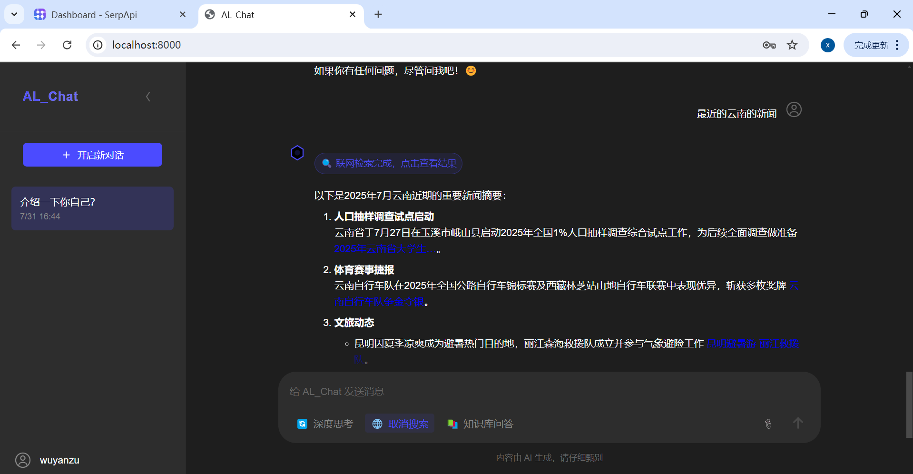

&emsp;&emsp;大模型在训练时使用大量的数据进行训练，一旦训练完成，其能回答的问题范围就仅限于训练数据中的问题，无法满足实际应用中对最新、实时知识和问答需求。因此在`2023年7月`，`OpenAI` 为其`GPT`系列模型推出了`Function Calling`功能，允许大模型在对话中调用外部工具，这个外部工具可以是连接数据库、搜索引擎、API等多种不同的形式。随后，基本上所有的大模型如`GLM-4`、`Qwen`等都陆续开始支持`Function Calling`功能，同样，`DeepSeek v3` 也支持`Function Calling`功能，并且和`OpenAI` 的`Function Calling`功能在使用规范上完全兼容。

&emsp;&emsp;因此这里大家要清楚的概念是：`Function Calling` 指的是函数调用，也就是允许大模型调用外部的工具（比如`Python`函数封装）。而所谓的支持`Function Calling`功能，它并不是大模型完全自动实现调用 + 响应的整个过程，而是需要开发者根据大模型的输出结果，然后通过手动实现的方式来完成这个流程，具体来说：

1. 常规对话类模型无论用户输入什么问题，大模型都会根据用户的问题给出回答，这个回答是基于大模型自身的知识库给出的。具备`Function Calling`功能的大模型，当用户的问题涉及到了某个外部工具的应用需求点，那么大模型会返回一个`Function Calling`的输出，这个输出告诉开发者，需要调用哪个外部工具，以及调用这个外部工具需要传入的参数是什么。

2. 开发者根据大模型返回的`Function Calling`的输出，执行这个外部函数，并且传入这个外部函数需要用到的参数，获取到外部函数执行后的返回结果。

3. 手动获取到外部工具的返回结果后，将结果与用户的原始问题一起给到大模型，大模型根据新的输入给出最终的回答。

&emsp;&emsp;`DeepSeek` 官方的 `API` 目前包含两类模型，分别是 `DeepSeek-chat` 和 `DeepSeek-reasoner`，其中两类模型的区别与`Function Calling` 功能支持情况如下：

<style>
.center 
{
  width: auto;
  display: table;
  margin-left: auto;
  margin-right: auto;
}
</style>

<p align="center"><font face="黑体" size=4>Function Calling 功能支持情况</font></p>
<div class="center">

| 模型名称          | 底层模型               | 支持 Function Calling |
|-------------------|------------------------|:-----------------------:|
| DeepSeek-chat     | 满血版 DeepSeek v3     |         是                    |
| DeepSeek-reasoner | 满血版 DeepSeek r1     | 否                    |

```bash
pip install openai
```

```bash
import json
from openai import OpenAI

class Chatbot:
    def __init__(self, model: str, base_url: str, api_key: str):

        # 初始化 OpenAI 客户端，该方式可以兼容在线API，同时也兼容使用 `ollama` 启动的 REST API
        self.client = OpenAI(
            base_url=base_url,
            api_key=api_key
        )
        self.model = model

    # 定义外部工具库
    # 1. 自定义函数
    def get_weather(self, location: str) -> str:
        """获取实时的天气数据，包括天气状况、温度"""
        weather_data = {
            "北京": "晴天，气温 40°C",
            "上海": "多云，气温 22°C",
            "广州": "小雨，气温 28°C",
            "深圳": "阴天，气温 27°C",
        }
        return weather_data.get(location, "城市未找到，无法提供天气信息。")

    # 2. 创建自定义函数的 JsonSchema 表示
    def create_tools(self):
        """创建工具定义"""
        return [
            {
                "type": "function",
                "function": {
                    "name": "get_weather",
                    "description": "Get real-time weather data, including weather conditions, temperatures",
                    "parameters": {
                        "type": "object",
                        "properties": {
                            "location": {
                                "type": "string",
                                "description": "The city name, e.g. Beijing",
                            }
                        },
                        "required": ["location"]
                    },
                }
            },
        ]

    # 对话主函数
    def chat(self, user_message: str):
        """
        对话函数
        """
        # 添加系统角色消息
        messages = [
            {"role": "system", "content": "你是一个智能助手，能够回答用户的问题并提供帮助。"},
            {"role": "user", "content": user_message}
        ]
        
        print('用户输入\t:', user_message)

        response = self.client.chat.completions.create(
            model=self.model,
            messages=messages,
            tools=self.create_tools()    # 通过tools参数传递工具的 JsonSchema 表示
        )

        # 检查 finish_reason
        finish_reason = response.choices[0].finish_reason

        if finish_reason == 'stop':
            # 普通问答处理
            print("模型输出\t:", response.choices[0].message.content)

        elif finish_reason == 'tool_calls':
            assistant_message = response.choices[0].message  # 获取 assistant 的消息        
            print('参数解析\t:', response.choices[0].message.tool_calls[0].function.arguments)
            
            # 将 assistant 的消息添加到 messages 列表中
            messages.append(assistant_message)
            
            # 处理工具调用
            tool_calls = response.choices[0].message.tool_calls
            if tool_calls:
                # 获取函数名称和参数
                function_name = tool_calls[0].function.name
                function_args = json.loads(tool_calls[0].function.arguments)

                # 定义可用的函数
                available_functions = {
                    "get_weather": self.get_weather,
                    # 可以在这里添加更多的函数
                }

                # 动态调用相应的函数
                if function_name in available_functions:
                    function_response = available_functions[function_name](**function_args)
                    print(f"执行结果: {function_response}")
                    # 添加工具调用的响应到消息中
                    messages.append({
                        "role": "tool",
                        "content": str(function_response),
                        "tool_call_id": tool_calls[0].id,
                    })

                    final_response = self.client.chat.completions.create(
                        model=self.model,
                        messages=messages,
                    )
      
                    print('最终回复\t:', final_response.choices[0].message.content)
                else:
                    print(f"Function {function_name} is not available.")
            else:
                print("No tool calls returned from model")
        else:
            print("Unknown finish reason:", finish_reason)
```

&emsp;&emsp;先测试一下`DeepSeek` 官方的`API`对`Function Calling` 功能的支持情况，测试代码如下：

```bash
import os


# 直接传入模型名称、base_url 和 api_key
api_key="sk-75d4081fd0ba4fafb81a2c38a7d3696e"
base_url="https://api.deepseek.com"
model_name = 'deepseek-chat'  # 模型名称

user_message = '北京的天气怎么样？'  # 输入
chatbot = Chatbot(model_name, base_url, api_key)
chatbot.chat(user_message)
```

```
用户输入	: 北京的天气怎么样？
参数解析	: {"location":"北京"}
执行结果: 晴天，气温 40°C
最终回复	: 北京目前是晴天，气温较高，达到了40°C，请注意防暑降温，外出时做好防晒措施！
```